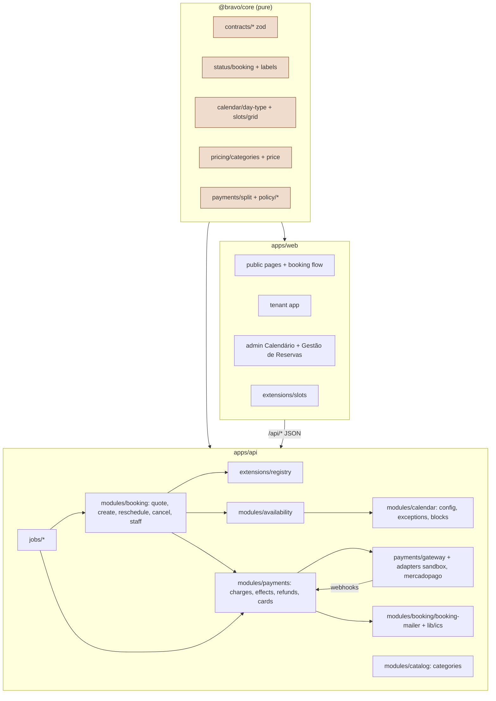
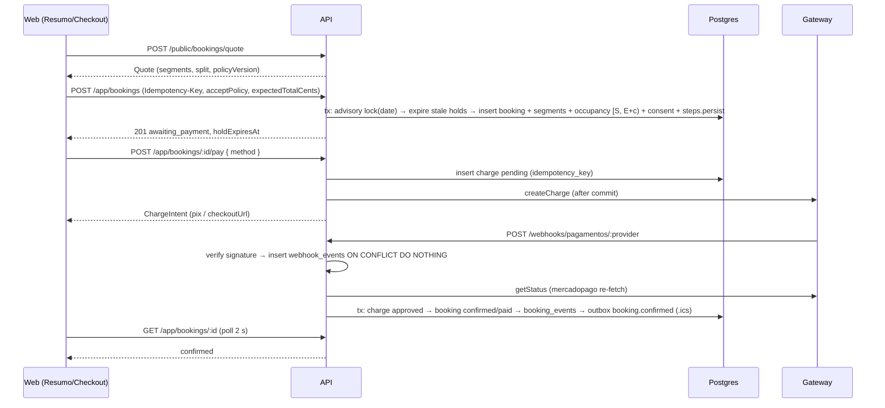

# Núcleo Design

**Spec**: `.specs/features/nucleo/spec.md`
**Global blueprint**: `docs/architecture.md` (data model §5.3, API conventions §6, core signatures §7, triggers §8, routes and components §9). This design adds only what núcleo needs on top of it.
**Decisions**: AD-001..AD-024 conform; new AD-032 (state-machine refinements), AD-033 (extension points and cross-feature ownership), AD-034 (payment-flow invariants), AD-035 (zod response contracts in core).
**Status**: Draft

---

## Architecture Overview

### Approaches considered

| Concern | Options | Decision |
| --- | --- | --- |
| Checkout hold expiry with a 5-min cron | (a) cron only; (b) lazy expiry in reads/writes + cron sweep; (c) DB-side TTL via `period` upper bound | **(b)**. Availability treats stale holds as free; booking creation expires overlapping stale holds in its own transaction; the job sweeps the rest. (c) breaks the `(kind, ref_id)` uniqueness and the cleanup semantics |
| Credits for cheaper reschedule (table owned by `receita`) | (a) núcleo creates `credit_lots` early; (b) depend on `receita`'s migration; (c) `CreditPort` with a deferred default | **(c)** (AD-033). (a) changes table ownership while `receita` plans in parallel; (b) inverts the delivery order |
| "Paga a diferença no ato" | (a) add difference to the balance; (b) move first, charge after; (c) hold the new slot with a system block, charge, move on approval | **(c)**. (a) is not "no ato"; (b) can strand the customer with no slot |
| Lane coupling (parallel backend/frontend) | (a) TypeScript types in web from prose; (b) zod response schemas in core used by API tests and web fixtures | **(b)** (AD-035). Contract drift becomes a failing test in either lane |

### Component map



### Booking and payment sequence



---

## Code Reuse Analysis

### Existing Components to Leverage (from fundação)

| Component | Location | How to Use |
| --- | --- | --- |
| Money/time helpers | `packages/core/src/money.ts`, `time.ts` | All arithmetic and São Paulo conversions |
| Settings catalog | `packages/core/src/settings/catalog.ts` | Read/validate every calendar/payment/policy key; `policySnapshot` reads from it |
| Holiday seed | `packages/core/src/calendar/holidays-seed.ts` | Already seeded; import upserts next to it |
| Access map | `packages/core/src/access.ts` | `reservas` sub-tab `politicas` admin-only; reception sections |
| App factory, errors, validation | `apps/api/src/app.ts`, `lib/errors.ts`, `middleware/validate.ts` | Mount núcleo routers; new error codes added to the `AppError` union |
| Auth chain | `middleware/auth.ts` (`requireAuth`, `requireStaff`, `requireRole('admin')`) | Route guards; add `requireVerifiedEmail` |
| Rate limiter | `middleware/rate-limit.ts` (`consumeRateLimit`) | 120/min/IP on availability and quote; 3-hold rule is a query, not a bucket |
| Audit | `lib/audit.ts` | Every staff action, same `tx` |
| Outbox | `lib/email.ts` (`queueEmail`, `dispatchEmails`) | All núcleo templates; `dedupeKey` for reminders |
| Crypto | `lib/crypto.ts` (`randomToken`, `sha256Hex`, `decryptSecret`) | Payment-link tokens, MP credentials, sandbox webhook HMAC |
| DB client and harness | `db/client.ts` (`withTransaction`), `test/setup.ts`, `test/factories.ts` | Integration tests; factories extended with `createBooking`, `createCategory` |
| Base tables | `rooms`, `business_hours`, `holidays`, `closed_days`, `blocks`, `block_recurrences`, `room_occupancy`, `consents`, `integration_settings` | Read/write as designed in architecture §5.2 |
| UI kit | `apps/web/src/components/ui/*` (Button, Field, Modal, Tabs, Card, Badge, Toast, RoomCard) | Every núcleo screen |
| Shells and guards | `AppShell`, `AdminShell`, `RequireAuth`, `RequireStaff`, `RequireSection` | Mount pages |
| Data layer | `lib/api.ts` (`api.*`, `ApiError`, `idempotencyKey` option), `lib/query-client.ts`, `useSession` | All hooks |

### Integration Points

| System | Integration Method |
| --- | --- |
| Postgres | New migrations `<n>_nucleo` + `<n>_nucleo_constraints`; seeds extended |
| Mercado Pago | REST via `fetch` (`https://api.mercadopago.com`), credentials from `integration_settings['gateway.mercadopago']` |
| BrasilAPI | `GET https://brasilapi.com.br/api/feriados/v1/{year}` → `[{ date, name, type }]` |
| Neon Function Triggers | `neon.ts` triggers → `/jobs/<name>`, verified with `parseTriggerDelivery` (`@neon/functions/triggers`) |
| Resend | Through fundação outbox |
| receita / gestao | `apps/api/src/extensions/registry.ts` and `apps/web/src/extensions/slots.tsx` (AD-033) |

---

## Components

### Core contracts and vocabulary (T1)

- **Purpose**: one source for request/response shapes, status codes and labels.
- **Location**: `packages/core/src/contracts/{public,app,admin,common}.ts`, `packages/core/src/status/booking.ts`, `packages/core/src/labels.ts`
- **Interfaces**:
  - `bookingStatusSchema`, `BOOKING_STATUSES`, `HOLDING_STATUSES = ['awaiting_payment','pre_reserved','held_for_renewal']`, `ACTIVE_STATUSES = [...HOLDING, 'confirmed','paid']`, `TERMINAL_STATUSES`
  - `canTransition(from: BookingStatus, to: BookingStatus): boolean`, `assertTransition(from, to)`
  - `paymentStatusOf(b: { status; paymentMode; balanceCents; refundedCents }): { code: PaymentStatusCode; label: string }`
  - `bookingStatusLabel`, `paymentModeLabel`, `chargeStatusLabel`, `holidayScopeLabel`
  - zod schemas named `<name>Schema` for every row of §API contract (requests and responses), types via `z.infer`.
- **Dependencies**: `zod`.

### Core calendar and grid (T2)

- **Location**: `packages/core/src/calendar/day-type.ts`, `packages/core/src/slots/grid.ts`
- **Interfaces**: exactly architecture §7.3 and §7.4 (`resolveDayType`, `businessWindow`, `validateInterval`, `generateSlotGrid`, `rejectMessage`), plus
  - `findCleanupConflicts(bookings: { id; roomId; start: Date; end: Date }[], newCleanupMinutes: number): { firstId: string; secondId: string }[]` (same room, sorted by start, pair when `prev.end + c > next.start`).
  - `occupiedFromBooking(b: { start; end; cleanupMinutes }): Occupied`, `occupiedFromBlock(b)`.

### Core pricing (T3)

- **Location**: `packages/core/src/pricing/categories.ts`, `packages/core/src/pricing/price.ts`
- **Interfaces**: architecture §7.5 (`selectHourlyCategory`, `priceHourlyBooking`, `priceBlockBooking`, `averageHourlyCents`, `vSlotForInterval`) plus
  - `categoryAverageHourlyCents(cat: AnyCategory): Cents` (hourly → weekday rate; block → price ÷ window hours; hour_package → price ÷ included hours; fixed_schedule → price per occurrence ÷ window hours; half-up via `mulDivRoundHalfUp`).
  - `coverageBands(cats: HourlyCategory[], day: { weekday; isHoliday }, window, durationMinutes): { bands: { categoryId; name; startMinute; endMinute; rateCents }[]; uncovered: { startMinute; endMinute }[] }`.
  - `fromPriceCents(cats: HourlyCategory[]): Cents | null`.

### Core split and policies (T4)

- **Location**: `packages/core/src/payments/split.ts`, `packages/core/src/policy/{cancellation,reschedule,policy-text}.ts`
- **Interfaces**: architecture §7.6 and §7.12 unchanged, plus
  - `settleReschedule(args: { oldNetCents; newNetCents; paidCents; depositCents }): { payNowCents; creditCents; newTotalCents; newPaidCents; newBalanceCents; newDepositCents }` with `payNow = max(0, newNet − oldNet)`; when cheaper `credit = max(0, paid − newNet)`, `newPaid = paid − credit`; when more expensive `newPaid = paid + payNow`; `newBalance = newTotal − newPaid`; `newDeposit = min(deposit, newNet)`.
  - `policySnapshot(values: SettingsValues): PolicySnapshot` and `renderPolicyText(snapshot): { title: string; paragraphs: string[] }[]`.

### Extension registry (T6)

- **Purpose**: the seam for `receita` and `gestao` (AD-033).
- **Location**: `apps/api/src/extensions/registry.ts` (types + `createRegistry(overrides)`), `apps/api/src/extensions/defaults.ts`, `apps/api/src/extensions/index.ts` (the one file later features edit to register).
- **Interfaces**:

```ts
export interface QuoteContext { db: Db | Tx; now: Date; user: { id: string; docNumber: string | null } | null;
  room: { id: string; slug: string; name: string }; date: LocalDate; startMinute: number; endMinute: number;
  isHoliday: boolean; request: QuoteRequest; settings: SettingsValues; categories: HourlyCategory[] }
export interface QuoteDraft { segments: PricedSegment[]; grossCents: Cents;
  discount: { source: 'none' | 'coupon' | 'slot_discount'; cents: Cents; label: string | null; ref?: unknown };
  extras: { label: string; amountCents: Cents; ref?: unknown }[];
  creditAvailableCents: Cents; paymentMode: PaymentMode | null; packageDebit: { minutes: number; detail: unknown } | null;
  extensions: Record<string, unknown>;   // public-safe per-step data (key = step name), serialized as Quote.extensions
  lines: QuoteLine[]; notices: string[] }
export interface CheckoutStep { name: string; order: number;            // discount 100, package 200, extras 300, credit 400
  apply(ctx: QuoteContext, draft: QuoteDraft): Promise<QuoteDraft>;    // no writes
  persist?(tx: Tx, booking: BookingRow, draft: QuoteDraft, ctx: QuoteContext): Promise<void>;
  release?(tx: Tx, booking: BookingRow, reason: 'expired' | 'cancelled', result?: CancellationResult): Promise<void>;   // result on cancellation (credit refunds)
  onConfirmed?(tx: Tx, booking: BookingRow): Promise<void> }
export interface PaymentModeHandler { mode: PaymentMode;
  reschedule?(tx: Tx, booking: BookingRow, next: QuoteDraft): Promise<{ payNowCents: Cents }>;
  cancel?(tx: Tx, booking: BookingRow, evaluation: CancellationResult): Promise<{ minutesReturned: number }> }
export interface CreditPort { mode: 'deferred' | 'live';
  availableCents(db: Db | Tx, userId: string, now: Date): Promise<Cents>;
  grant(tx: Tx, input: { userId: string; amountCents: Cents; source: 'reschedule_difference' | 'clinic_cancellation';
    refType: 'booking'; refId: string; ctx: RequestContext }): Promise<{ creditLotId: string | null }> }
export interface ClosedDayCompensationPort {
  preview(db: Db | Tx, args: { date: LocalDate; roomIds: string[] | null }): Promise<{ subscribers: number; minutes: number; creditCents: Cents; fixedOccurrencesCancelled: number }>;
  apply(tx: Tx, closedDayIds: string[], ctx: RequestContext): Promise<void> }
export interface AvailabilityDecorator { decorate(db: Db, args: { roomId: string; date: LocalDate; cells: PublicCell[] }): Promise<PublicCell[]> }
export interface CategoryHandler { type: 'hour_package' | 'fixed_schedule'; schema: z.ZodType; toRow(input: unknown): Partial<CategoryRow>;
  onUpdate?(tx: Tx, before: CategoryRow, after: CategoryRow, ctx: RequestContext): Promise<void> }   // may throw 409, queue notices
export type ChargePurposeHandled = 'subscription_initial' | 'subscription_renewal' | 'extra_hours' | 'extra_service';
export interface ChargeHandler { onApproved(tx: Tx, ctx: RequestContext, charge: ChargeRow): Promise<void>;
  onFailed(tx: Tx, ctx: RequestContext, charge: ChargeRow, status: NormalizedStatus): Promise<void> }
export type StaffEvent = 'new_booking' | 'payment_received' | 'booking_cancelled' | 'pre_reservation_expired' | 'payment_issue' | 'new_subscription' | 'renewal_failed';
export interface NotificationPort { notifyStaff(event: StaffEvent, payload: { entityId: string } & Record<string, unknown>): Promise<void> }   // entityId feeds gestao's dedupe key
export interface RoomMediaPort { photoUrl(storageKey: string): string | null }
export interface Registry { checkoutSteps: CheckoutStep[]; paymentModeHandlers: PaymentModeHandler[]; credits: CreditPort;
  closedDayCompensation: ClosedDayCompensationPort; availabilityDecorators: AvailabilityDecorator[];
  categoryHandlers: CategoryHandler[]; chargeHandlers: Partial<Record<ChargePurposeHandled, ChargeHandler>>;
  notifications: NotificationPort; roomMedia: RoomMediaPort }
```

- Deferred `CreditPort.grant` inserts nothing new: the calling service passes the grant into the `booking_events.data` of the same transition (`creditGrant: { amountCents, status: 'deferred' }`).
- The registry is part of `AppDeps` (fundação `createApp(deps)`), so tests inject fakes.
- Service signature convention for everything another feature or an MCP tool may call: `(db | tx, ctx: RequestContext, input)` with the input zod schema exported from `@bravo/core/contracts`.
- Exported booking helpers (stable names for `receita`): `insertBookingWithOccupancy(tx, row)` (23P01 → `SLOT_TAKEN` with the conflicting start), `transitionBooking(tx, ctx, id, from[], to, reason, data?)`, `newBookingCode()`, `buildIcs(input)` (§Mail and ICS; one or more VEVENTs), `loadDayContexts(db, { roomId, dates })` (window, occupied, closed per date), `getReferenceCategory(db)`.
- Staff-event call sites (gestao GES-69), all after commit with `entityId`: booking first reaching `confirmed`/`paid` (approval, zero pay-now, manual confirmation) → `new_booking`; approved non-credit charge of any purpose → `payment_received`; any `cancelled_*` transition (tenant, clinic, nonpayment job) → `booking_cancelled`; pre-reservation expiry → `pre_reservation_expired`; refund failed after 5 attempts → `payment_issue`. Receita calls `new_subscription` / `renewal_failed` from its charge handlers.
- Every checkout step may write `draft.extensions[step.name]`; `buildQuote` serializes it unchanged as `Quote.extensions` (receita's `revenueQuoteSchema` and gestao's extras picker parse their own key). `netCents = grossCents − discount.cents + Σ extras.amountCents`; `bookings.total_cents = netCents` (extras lines are persisted by the owning step, gestao `booking_extra_items`).
- Fixed occurrences (`kind = 'fixed_occurrence'`) are owned by `receita`: `expire-holds` skips them, and closed-day preview/apply hand them to `ClosedDayCompensationPort` instead of counting them as blockers.

### Availability (T7)

- **Location**: `apps/api/src/modules/availability/availability.service.ts`, `apps/api/src/modules/calendar/calendar.repo.ts`, `apps/api/src/routes/public/availability.ts`
- **Interfaces**:
  - `loadCalendarInputs(db, { roomId, from: LocalDate, to: LocalDate, now }): Promise<{ hours; holidays; closedDays; occupied: Map<LocalDate, Occupied[]>; settings }>` — one query each; occupancy query: `room_occupancy` active rows overlapping the range joined to bookings to drop stale holds (`NOT (b.status IN holding AND b.hold_expires_at <= now)`).
  - `getDayAvailability(db, roomSlug, date, now, registry): Promise<AvailabilityDay>`; `getMonthAvailability(db, roomSlug, month, now): Promise<AvailabilityMonth>`; `getAdminDay(db, roomId, date, now)` (admin cells with `adminState`).
  - `findAffectedBookings(db|tx, predicate: { roomIds?: string[] | null; dates?: LocalDate[]; outsideWindows?: Map<dayType, window> ; from: Date }): Promise<AffectedBooking[]>` — used by T10/T11.

### Catalog and quote (T8, T9)

- **Location**: `apps/api/src/routes/public/catalog.ts` (+ `modules/catalog/catalog.service.ts`), `apps/api/src/modules/booking/quote.service.ts`, `apps/api/src/routes/public/quote.ts`
- **Interfaces**: `buildQuote(db, request, { now, user, registry }): Promise<{ ok: true; quote: Quote; draft: QuoteDraft; ctx: QuoteContext } | { ok: false; error: AppError }>` — validate interval (T2), price (T3), apply steps (sorted by `order`), `splitPayment` with `creditAvailableCents`, render memory lines. Lines: one per segment, then `discount`, `extras`, `credit`, `total`, `deposit`, `balance`.

### Calendar administration (T10–T13)

- **Location**: `apps/api/src/modules/calendar/{calendar-config,exceptions,blocks}.service.ts`, `apps/api/src/modules/catalog/categories.service.ts`, `apps/api/src/modules/settings/policies.service.ts`, routes under `apps/api/src/routes/admin/{calendar,blocks,categories,settings,onboarding}.ts`
- **Interfaces**:
  - `updateBusinessHours(tx, rows, ctx)`, `updateCalendarSettings(tx, input, ctx): { settings; warnings }`, `updatePolicies(tx, input, ctx): { version }`.
  - `importNationalHolidays(db, year, deps: { fetch; now }, opts?: { renameExisting?: boolean }): Promise<{ inserted; updated }>` (exported for gestao; admin import renames existing nationals, gestao's weekly job passes `renameExisting: false` = insert-only, GES-131).
  - `createClosedDays(tx, input, ctx, registry)`, `previewClosedDay(db, input, registry)`.
  - `createBlocks(tx, input, ctx)`, `deleteBlock(tx, id, ctx)`, `createRecurrence(tx, input, ctx)`, `materializeRecurrences(db, now): Promise<{ created; skipped }>`.
  - `listCategories`, `createCategory`, `updateCategory`, `setReference`, `reorderCategories`.
- Advisory lock helper `lockCalendarDate(tx, date)` = `SELECT pg_advisory_xact_lock(hashtext('cal:' || $date))`; booking creation, reschedule and closed-day/holiday closing take it for every local date they touch, in ascending date order.

### Mail and ICS (T14)

- **Location**: `apps/api/src/lib/ics.ts`, `apps/api/src/emails/templates/booking-*.ts`, `apps/api/src/modules/booking/booking-mailer.ts`
- **Interfaces**: `buildIcs({ method: 'PUBLISH' | 'REQUEST' | 'CANCEL'; events: { uid; sequence; start; end; summary; location; description; status?: 'CONFIRMED' | 'TENTATIVE' | 'CANCELLED' }[]; organizerEmail? }): string` (gestao T8 re-implements it over `icsEvent`/`icsCalendar` with the same signature); `bookingMailer.{confirmed, rescheduled, cancelled, cancelledNonpayment, reminder24h, reminder2h, balanceCharge, balanceReminder, balanceCharged, balanceCardFailed, preReservationLink, preReservationExpired, lateApprovalRefund, setPassword}(tx, booking|user, extra)` (the single núcleo notification helper that gestao rewires to `emit()`, AD-025) → `queueEmail` with templates `booking.confirmed`, `booking.rescheduled`, `booking.cancelled`, `booking.cancelled_nonpayment`, `booking.reminder_24h`, `booking.reminder_2h`, `booking.balance_charge`, `booking.balance_reminder`, `booking.balance_charged`, `booking.balance_card_failed`, `booking.pre_reservation_link`, `booking.pre_reservation_expired`, `booking.late_approval_refund`, `account.set_password`.

### Payments (T15–T19)

- **Location**: `apps/api/src/payments/gateway.ts`, `payments/resolver.ts`, `payments/adapters/{sandbox,mercadopago}.ts`, `modules/payments/{charges,payment-effects,refunds,cards}.service.ts`, `lib/idempotency.ts`, routes `routes/app/{payments,cards}.ts`, `routes/webhooks/pagamentos.ts`, `routes/public/sandbox.ts`
- **Interfaces**:

```ts
export type ProviderId = 'sandbox' | 'mercadopago';
export type NormalizedStatus = 'pending' | 'approved' | 'rejected' | 'cancelled' | 'expired' | 'refunded' | 'partially_refunded' | 'charged_back';
export interface CreateChargeInput { chargeId: string; idempotencyKey: string; method: 'pix' | 'card'; amountCents: Cents;
  description: string; payer: { email: string; name: string; docType: 'cpf' | 'cnpj'; docNumber: string }; expiresAt: Date; returnUrl: string }
export interface ChargeResult { externalId: string | null; status: NormalizedStatus; pixQrCode?: string; pixQrCodeBase64?: string; checkoutUrl?: string; feeCents?: Cents; raw: unknown }
export interface PaymentGateway { id: ProviderId;
  createCharge(i: CreateChargeInput): Promise<ChargeResult>;
  chargeSavedCard(i: { chargeId; idempotencyKey; amountCents; description; customerId: string; cardId: string; payerEmail: string }): Promise<ChargeResult>;
  getStatus(ref: { externalId: string | null; chargeId: string }): Promise<ChargeResult | null>;   // null = not found at provider
  cancelCharge(ref: { externalId: string | null; chargeId: string }): Promise<void>;
  refund(i: { externalId: string; amountCents: Cents; idempotencyKey: string }): Promise<{ externalId: string; status: 'approved' | 'pending' | 'failed' }>;
  ensureCustomer(u: { userId; email; name; docType; docNumber; existingId?: string }): Promise<{ customerId: string }>;
  saveCard(i: { customerId: string; cardToken: string }): Promise<{ cardId: string; brand: string; last4: string; expMonth: number; expYear: number }>;
  parseWebhook(req: { headers: Record<string, string>; rawBody: string; query: Record<string, string> }): Promise<{ valid: false } | { valid: true; externalId: string; externalStatus: string; chargeId?: string }>;
  verifyCredentials(creds: Record<string, string>, environment: 'test' | 'production'): Promise<{ ok: boolean; message: string }> }   // sandbox always ok; MP GET /users/me
export function resolveGateway(provider: ProviderId, deps: { db; env; fetch }): Promise<PaymentGateway>;   // throws GATEWAY_NOT_CONFIGURED
export function listGatewayAdapters(): { provider: ProviderId; label: string; credentialFields: { key: string; label: string; secret: boolean }[] }[];
```

  - `idempotent(route: string)` middleware: requires `Idempotency-Key` (UUID), stores `(user_id, key, route, request_hash)` before running the handler, replays stored response, 422 on hash mismatch.
  - Generic charge API (booking or not): `createCharge(tx, ctx, { purpose, userId, bookingId?, amountCents, method, savedCardId?, expiresAt, description })`, `submitCharge(db, chargeId)` (gateway call after commit), `refundCharge(tx, ctx, { chargeId, amountCents, reason })`, `cancelCharge(tx, ctx, chargeId)`, `listSavedCards(db, userId)`; `createChargeForBooking` wraps `createCharge` with booking rules. Gateway `fee_cents` and `approved_at` are always filled on approval (sandbox fee 0) for gestao finance (AD-027).
  - `applyProviderStatus(db, { provider, externalId, chargeId?, status, amountCents?, raw }): Promise<void>` — the single effects entry used by webhooks, sandbox and reconcile; locks charge then booking `FOR UPDATE`; dispatches by `purpose`: booking purposes run núcleo effects; other purposes call `registry.chargeHandlers[purpose]` in the same transaction.
  - `requestRefund(tx, { chargeId, amountCents, reason, ctx })`, `processPendingRefunds(db, now)`.
  - Sandbox adapter: no network; `createCharge` returns `externalId = 'sbx_' + chargeId`, `checkoutUrl = APP_BASE_URL + '/pagamento/sandbox/' + chargeId`, fake Pix `pixCopyPaste = '00020126SANDBOX' + chargeId`; webhook HMAC-SHA256 over the raw body with a key derived as `sha256(SESSION_SECRET + ':sandbox-webhook')`.
  - **Uncertain (verify before coding, Knowledge chain step 3/4)**: Mercado Pago saved-card charge without CVV (`POST /v1/card_tokens { card_id }`), Checkout Pro `expiration_date_to` behavior, and the exact `x-signature` manifest. The adapter's unit tests encode this design; the worker updates both if the official docs differ and notes it in the commit.

### Booking lifecycle (T20–T25)

- **Location**: `apps/api/src/modules/booking/{create-booking,reschedule,cancel,staff-booking,booking-serializer}.service.ts`, `modules/admin/{booking-queries,customers}.service.ts`, routes `routes/app/bookings.ts`, `routes/admin/bookings.ts`, `routes/admin/customers.ts`, `routes/public/pre-reservations.ts`, `routes/app/me.ts` (PATCH added)
- **Interfaces**:
  - `createBooking(db, input, { user, source, staff?, now, registry, ctx }): Promise<BookingRow>` (tenant and staff paths share it).
  - `serializeBookingDetail(db, bookingId, viewer, now): Promise<BookingDetail>`; `computeActions(booking, now)`.
  - `quoteReschedule`, `applyReschedule(tx, booking, target, { actor: 'tenant' | 'admin'; exception?; differenceHandling?; justification? })`, `applyRescheduleRequest(tx, requestId)` (called from payment effects).
  - `previewCancellation(booking, now, actor)`, `cancelBooking(tx, booking, { actor; reason; resolution?; ctx })`.
  - `staffCreateBooking`, `confirmManual`, `resendPaymentLink`, `checkIn`, `setCleanupException`, `resolvePaymentLinkToken`.
  - `adminCalendarEvents(db, filters)`, `listBookings(db, filters, cursor)`, `exportBookingsCsv(db, filters): Promise<string>`, `searchCustomers`, `createCustomer`.
- Status changes go through `transitionBooking(tx, ctx, id, from: BookingStatus[], to, reason, data?)` (actor and origin from `ctx`), which asserts `canTransition`, runs the guarded update, writes `booking_events`, and deactivates occupancy on terminal states (NUC-05/06).

### Jobs (T26–T28)

- **Location**: `apps/api/src/routes/jobs.ts`, `apps/api/src/jobs/{runner,expire-holds,charge-balances,reminders,no-shows,reconcile-payments,materialize-blocks}.ts`, `apps/api/src/lib/trigger-auth.ts`, root `neon.ts`
- **Interfaces**: `type Job = (deps: JobDeps, now: Date) => Promise<Record<string, number | boolean>>`; `registerJob(name, job)` (used by receita and gestao jobs); `runJob(name, job, deps)` takes `pg_try_advisory_lock(hashtext('job:' || name))`, writes `job_runs`; `verifyTriggerRequest(req): Promise<{ invocationId: string } | null>` wraps `parseTriggerDelivery` (signature from the neon-functions skill; stubbed in tests through `AppDeps.verifyTrigger`).

### Web (T29–T48)

- **Extension slots** `apps/web/src/extensions/slots.tsx`: `slots: Record<SlotName, ComponentType<any> | ComponentType<any>[] | null>` and `<Slot name props />`. Names: `pricing.packages`, `checkout.summary.discount`, `checkout.summary.credits`, `checkout.summary.payWith`, `checkout.summary.extras` (gestao's `CheckoutAddonsSlot`, props `{ draft, onChange(addons) }`), `booking.detail.extra`, `admin.calendar.freeSlotActions`, `admin.calendar.overlays`, `admin.categories.forms`, `admin.reservations.tabs`, `admin.reservations.headerActions`.
- **Reusable for later features**: `PaymentMethodPanel` (given a `ChargeIntent` or a pay callback), `WeekCalendar` `onRangeSelect` and `markers` props, booking popup field `packageMinutes`, exported `useCustomerSearch`.
- **Test infra** `apps/web/src/test/msw/{server,handlers}.ts` + `apps/web/src/test/fixtures/nucleo.ts` (every fixture parsed by the core contract schema at import time, so a contract change breaks the web tests).
- **Hooks** per domain in `apps/web/src/features/<domain>/api.ts`: `useRooms`, `useRoom`, `useCatalog`, `useClinic`, `usePolicies`, `useDayAvailability`, `useMonthAvailability`, `useQuote`, `useCreateBooking`, `usePay`, `useMyBookings(tab)`, `useBooking(id, { poll })`, `useRescheduleQuote`, `useReschedule`, `useCancellationPreview`, `useCancel`, `useCards`, admin hooks `useCalendarConfig`, `useHolidays`, `useClosedDayPreview`, `useCategories`, `useCalendarEvents`, `useAdminBookings`, `usePolicySettings`, `useCustomerSearch` and the mutations of each.
- **Components** (architecture §9.5, núcleo rows): `Popover`/`HoverCard`, `Drawer`, `Stepper`, `Table` (+`useCsvDownload`), `StatusBadge`, `PriceTag`, `BookingSummary`, `PolicyAcceptance`, `MonthCalendar` (picker), `SlotGrid`, `WeekCalendar`, `MonthCalendarView`, `DayView`, `CategoryBandOverlay`, `WeekHoursEditor`.
- **Pages**: public `RoomsPage`, `RoomPage`, `PricingPage`, `PoliciesPage`, `ContactPage`, `LegalPage`, `BookingFlowPage` (`/reservar`, `/app/reservar`), `CheckoutPage`, `SandboxCheckoutPage`, `PreReservationPage`; app `AppHomePage`, `MyBookingsPage`, `BookingDetailPage`, `AgendaPage`, `ProfilePage`, `CardsPage`; admin `CalendarConfigPage` (`/admin/calendario`), `ReservationsPage` with sub-tabs `calendario`, `lista`, `politicas` (+ slot `admin.reservations.tabs`).
- **Card tokenizers** `apps/web/src/features/payments/tokenizers.ts`: `sandbox` (form with fake number → `tok_sandbox_<last4>`, never sent to the API) and `mercadopago` (loads `https://sdk.mercadopago.com/js/v2`, `mp.createCardToken`).
- **Analytics** `apps/web/src/lib/analytics.ts`: `track(event, props)`.

---

## API Contract

Public paths shown (native paths drop `/api`). All bodies JSON camelCase; money in cents; instants ISO UTC; `LocalDate` `YYYY-MM-DD`; minutes of day integers. Schemas live in `packages/core/src/contracts/*` with the names in the last column (AD-035). `IK` = requires `Idempotency-Key`.

### Shared shapes

```ts
type Photo = { url: string; alt: string; width: number | null; height: number | null }
type RoomSummary = { id: string; slug: string; name: string; description: string; idealFor: string[]; equipment: string[]; cover: Photo | null; fromPriceCents: number | null }
type PublicCell = { startMinute: number; available: boolean; maxEndMinute: number | null; discountPercent?: number }
type AdminCell = PublicCell & { adminState: 'free' | 'booking' | 'cleanup' | 'block' | 'leftover' | 'closed' | 'past' }
type QuoteSegment = { startMinute: number; endMinute: number; minutes: number; categoryId: string | null; categoryName: string; dayType: 'weekday' | 'weekend_holiday'; rateCentsPerHour: number | null; amountCents: number }
type QuoteLine = { kind: 'segment' | 'discount' | 'extra' | 'credit' | 'total' | 'deposit' | 'balance' | 'package'; label: string; amountCents: number | null; detail?: string }
type PaymentPlan = { mode: 'deposit_balance' | 'full_upfront' | 'package' | 'subscription' | 'manual'; depositCents: number; balanceCents: number; payNowCents: number; creditUsedCents: number; balanceChargeAt: string | null; balanceDueAt: string | null }
type Quote = { roomId: string; roomSlug: string; roomName: string; date: string; startMinute: number; endMinute: number; durationMinutes: number; blockCategoryId: string | null;
  segments: QuoteSegment[]; grossCents: number; discount: { source: 'none' | 'coupon' | 'slot_discount'; cents: number; label: string | null }; extrasCents: number;
  netCents: number; creditAvailableCents: number; payment: PaymentPlan; policyVersion: number; holdMinutes: number; lines: QuoteLine[]; notices: string[];
  extensions: Record<string, unknown> }   // per checkout step (receita: discount, package, credit; gestao: extras)
type BookingSummary = { id: string; code: string; kind: 'single' | 'fixed_occurrence'; roomId: string; roomSlug: string; roomName: string; startsAt: string; endsAt: string;
  status: BookingStatus; statusLabel: string; paymentStatus: { code: PaymentStatusCode; label: string }; totalCents: number; paidCents: number; balanceCents: number;
  balanceDueAt: string | null; holdExpiresAt: string | null; group: { id: string; label: string } | null }
type BookingDetail = BookingSummary & { segments: QuoteSegment[]; grossCents: number; discountCents: number; discountSource: string; creditAppliedCents: number; depositCents: number;
  paymentMode: PaymentPlan['mode']; cleanupMinutes: number; rescheduleCount: number; checkedInAt: string | null; source: string;
  charges: { id: string; purpose: string; method: string; amountCents: number; status: string; createdAt: string; approvedAt: string | null }[];
  refunds: { id: string; amountCents: number; status: string; createdAt: string }[];
  pendingReschedule: { id: string; startsAt: string; endsAt: string; payNowCents: number; expiresAt: string; chargeId: string } | null;
  policy: { version: number; sections: { title: string; paragraphs: string[] }[] };
  actions: { canPay: boolean; canPayBalance: boolean; canReschedule: boolean; rescheduleBlockedReason: 'too_late' | 'limit_reached' | 'status' | 'payment_mode' | null; canCancel: boolean } }
type ChargeIntent = { chargeId: string; method: 'pix' | 'card' | 'saved_card'; status: string; amountCents: number; expiresAt: string | null; pixQrCodeBase64: string | null; pixCopyPaste: string | null; checkoutUrl: string | null }
type AffectedBooking = { id: string; code: string; customerName: string; roomName: string; startsAt: string; endsAt: string; status: BookingStatus }
```

### Public (`/api/public`, no auth)

| Method | Path | Request | 2xx response | Errors | Schemas |
| --- | --- | --- | --- | --- | --- |
| GET | `/rooms` | — | `{ items: RoomSummary[] }` | — | `roomListSchema` |
| GET | `/rooms/:slug` | — | `RoomSummary & { photos: Photo[] }` | 404 | `roomDetailSchema` |
| GET | `/catalog` | — | `{ hourly: { id, name, weekdays, appliesOnHolidays, startMinute, endMinute, weekdayRateCents, weekendRateCents, minDurationMinutes, displayOrder, isReference }[]; blocks: { id, name, weekdays, appliesOnHolidays, startMinute, endMinute, fixedPriceCents, averageHourlyCents }[]; pricesReviewed: boolean }` | — | `catalogSchema` |
| GET | `/clinic` | — | `{ addressLine, whatsappE164, contactEmail, businessHours: BusinessHoursRow[] }` | — | `clinicSchema` |
| GET | `/policies` | — | `{ version, values: PolicySnapshot, sections }` | — | `policiesPublicSchema` |
| GET | `/rooms/:slug/availability?date` | — | `{ date, roomSlug, isHoliday, holidayName, closed, outOfRange, window, slotMinutes, minBookingMinutes, cells: PublicCell[], blockOptions: { categoryId, name, startMinute, endMinute, priceCents, available }[] }` | 404, 422, 429 | `availabilityDaySchema` |
| GET | `/rooms/:slug/availability/month?month` | — | `{ month, days: { date, status: 'available' \| 'full' \| 'closed' \| 'past' \| 'out_of_range', isHoliday, holidayName, hasDiscount }[] }` | 404, 422, 429 | `availabilityMonthSchema` |
| POST | `/bookings/quote` | `{ roomSlug, date, startMinute, endMinute, blockCategoryId?, couponCode?, useCredits?, payWith?: 'money' \| 'package', addons?: Record<string, unknown> }` | `Quote` | 422 `SLOT_UNAVAILABLE` / `NO_CATEGORY` / `VALIDATION_FAILED`, 429 | `quoteRequestSchema`, `quoteSchema` |
| GET | `/pre-reservations/:token` | — | `{ bookingId, code, roomName, startsAt, endsAt, totalCents, holdExpiresAt, customerFirstName }` | 404 | `preReservationPublicSchema` |
| GET | `/payment-config` | — | `{ provider, publicKey, environment: 'test' \| 'production' }` | — | `paymentConfigSchema` |
| GET | `/sandbox/charges/:chargeId` | — | `{ id, amountCents, method, status, purpose, bookingCode, bookingId, expiresAt, pixCopyPaste }` | 404 | `sandboxChargeSchema` |
| POST | `/sandbox/charges/:chargeId/approve` / `/reject` | `{}` | `{ status }` | 403 (production, non-staff), 404, 409 not pending | `sandboxActionSchema` |

### App (`/api/app`, session)

| Method | Path | Request | 2xx response | Errors | Schemas |
| --- | --- | --- | --- | --- | --- |
| POST | `/bookings` IK | `quoteRequest & { acceptPolicy: true, policyVersion, expectedTotalCents }` | 201 `BookingDetail` | 403 `EMAIL_NOT_VERIFIED`; 409 `SLOT_TAKEN`, `POLICY_CHANGED`, `PRICE_CHANGED`, `BOOKING_NOT_OPEN`; 422 `PROFILE_INCOMPLETE`, `SLOT_UNAVAILABLE`, `NO_CATEGORY`, `IDEMPOTENCY_MISMATCH`; 429 | `createBookingSchema`, `bookingDetailSchema` |
| GET | `/bookings?tab&cursor` | — | `{ items: BookingSummary[], nextCursor }` | 422 | `bookingListSchema` |
| GET | `/bookings/:id` | — | `BookingDetail` | 404 | `bookingDetailSchema` |
| GET | `/bookings/:id/ics` | — | `text/calendar` | 404 | — |
| POST | `/bookings/:id/pay` IK | `{ method: 'pix' \| 'card' \| 'saved_card', savedCardId?, acceptPolicy?, policyVersion? }` | `ChargeIntent` | 404; 409 `HOLD_EXPIRED`, `INVALID_TRANSITION`; 422 `POLICY_ACCEPTANCE_REQUIRED`; 502 `GATEWAY_ERROR`; 503 `GATEWAY_NOT_CONFIGURED` | `payRequestSchema`, `chargeIntentSchema` |
| POST | `/bookings/:id/pay-balance` IK | `{ method, savedCardId? }` | `ChargeIntent` | as above | same |
| GET | `/bookings/:id/reschedule/availability?date` | — | `availabilityDay` of the booking's room without the booking's own occupancy | 404, 422 | `availabilityDaySchema` |
| POST | `/bookings/:id/reschedule/quote` | `{ roomSlug?, date, startMinute, endMinute }` | `{ allowed, reason, message, newQuote: Quote \| null, settlement: { payNowCents, creditCents, newTotalCents, newBalanceCents } \| null }` | 404 | `rescheduleQuoteSchema` |
| POST | `/bookings/:id/reschedule` IK | same + `{ method? }` (required when pay-now > 0) | 200 `BookingDetail & { creditCents }` or 202 `{ rescheduleRequestId, expiresAt, charge: ChargeIntent }` | 409 `SLOT_TAKEN`; 422 `POLICY_VIOLATION`, `SLOT_UNAVAILABLE` | `rescheduleRequestSchema`, `rescheduleResultSchema` |
| GET | `/bookings/:id/cancellation-preview` | — | `{ retainedCents, refundCents, minutesReturned, creditCents }` | 404, 409 | `cancellationPreviewSchema` |
| POST | `/bookings/:id/cancel` IK | `{ reason? }` | `BookingDetail` | 404, 409 | `cancelRequestSchema` |
| GET | `/cards` | — | `{ items: { id, brand, last4, expMonth, expYear, recurringConsentAt }[] }` | — | `savedCardListSchema` |
| POST | `/cards` | `{ cardToken, recurringConsent: true }` | 201 card | 422, 502 | `saveCardSchema` |
| DELETE | `/cards/:id` | — | 204 | 404 | — |
| PATCH | `/me` | `{ name?, phone?, profession?, professionalRegistry?, document? }` | me payload + `{ phone, profession, professionalRegistry, document }` | 409 `DOCUMENT_TAKEN`, 422 | `updateMeSchema`, `meSchema` |

### Admin (`/api/admin`, staff + MFA; **A** = admin only)

| Method | Path | Request | 2xx response | Errors |
| --- | --- | --- | --- | --- |
| GET **A** | `/calendar/config` | — | `{ businessHours, settings: { slotMinutes, defaultBookingMinutes, cleanupMinutes, minAdvanceMinutes, maxAdvanceDays }, warnings, onboarding: { pricesReviewed } }` | — |
| PUT **A** | `/calendar/business-hours` | `{ rows: BusinessHoursRow[8] }` | `{ businessHours }` | 409 `AFFECTED_BOOKINGS`, 422 |
| PUT **A** | `/calendar/settings` | `{ slotMinutes, defaultBookingMinutes, cleanupMinutes, minAdvanceMinutes, maxAdvanceDays }` | `{ settings, warnings: { code, lostMinutesPerBooking }[] }` | 409 `CLEANUP_CONFLICTS`, 422 |
| GET **A** | `/calendar/holidays?year` | — | `{ items: { id, date, name, scope, source, isClosed, needsReview, alert }[] }` | 422 |
| POST **A** | `/calendar/holidays` | `{ date, name, scope }` | 201 holiday | 409 `CONFLICT`, 422 |
| PATCH **A** | `/calendar/holidays/:id` | `{ isClosed?, name?, needsReview? }` | holiday | 409 `AFFECTED_BOOKINGS` |
| DELETE **A** | `/calendar/holidays/:id` | — | 204 | 422 non-manual |
| POST **A** | `/calendar/holidays/import` | `{ year }` | `{ inserted, updated }` | 422, 502 `EXTERNAL_UNAVAILABLE` |
| GET | `/calendar/closed-days?from&to` | — | `{ items: { id, date, roomId, roomName, reason }[] }` | — |
| GET **A** | `/calendar/closed-days/preview?date&roomIds` | — | `{ affectedBookings: AffectedBooking[], compensation: { subscribers, minutes, creditCents, fixedOccurrencesCancelled } }` | 422 |
| POST **A** | `/calendar/closed-days` | `{ date, roomIds: string[] \| null, reason? }` | 201 `{ items, compensation }` | 409 `AFFECTED_BOOKINGS`, 422 |
| DELETE **A** | `/calendar/closed-days/:id` | — | 204 | 404 |
| GET | `/blocks?from&to&roomId` | — | `{ items: { id, roomId, tag, startsAt, endsAt, recurrenceId }[] }` | — |
| POST | `/blocks` | `{ roomIds, tag, date, startMinute, endMinute }` | 201 `{ items }` | 409 `SLOT_TAKEN`, 422 |
| DELETE | `/blocks/:id` | — | 204 | 404 |
| GET **A** | `/block-recurrences` | — | `{ items }` | — |
| POST **A** | `/block-recurrences` | `{ roomIds, tag, weekdays, startMinute, endMinute, validFrom, validUntil?, skipConflicts? }` | 201 `{ items, created, skipped: { roomId, date }[] }` | 409 `SLOT_TAKEN` (`details.dates`) |
| DELETE **A** | `/block-recurrences/:id` | — | 204 | 404 |
| GET **A** | `/categories` | — | `{ items: { ...row, averageHourlyCents, editable }[] }` | — |
| POST **A** | `/categories` | hourly or block body (discriminated by `type`) | 201 | 422 |
| PATCH **A** | `/categories/:id` | partial | category | 422 |
| POST **A** | `/categories/:id/reference` | — | category | 422 |
| POST **A** | `/categories/reorder` | `{ ids }` | `{ items }` | 422 |
| POST **A** | `/onboarding/prices-reviewed` | — | `{ pricesReviewed: true }` | — |
| GET/PUT **A** | `/settings/policies` | policy values (PUT) | `{ version, values }` | 422 |
| GET | `/calendar/events?from&to&roomId&status&categoryId` | — | `{ bookings: { id, code, firstName, fullName, roomId, roomName, status, statusLabel, paidCents, totalCents, packageMinutes, startsAt, endsAt, cleanupUntil, categoryNames, checkedInAt, holdExpiresAt }[], blocks, closedDays, holidays }` (`packageMinutes` is 0 until receita T13 fills it from `bookings.package_minutes_debited + extra_minutes_debited`) | 422 |
| GET | `/rooms/:roomId/availability?date` | — | `availabilityDay` with `AdminCell[]` | 422 |
| GET | `/bookings?q&status&roomId&categoryId&from&to&cursor` | — | `{ items: (BookingSummary & { customerName, customerEmail, source })[], nextCursor }` | 422 |
| GET | `/bookings/export.csv` | same filters | `text/csv` | 422 |
| GET | `/bookings/:id` | — | `BookingDetail & { customer: { id, name, email, phone } }` | 404 |
| POST | `/bookings` | `{ userId, roomId, date, startMinute, endMinute, blockCategoryId?, kind: 'booking' \| 'pre_reservation', expiresInHours?, confirmManually?, justification? }` | 201 `BookingDetail & { paymentLink }` | 403 (reception + confirmManually), 409, 422 |
| POST **A** | `/bookings/:id/confirm-manual` | `{ justification }` | `BookingDetail` | 409, 422 |
| POST | `/bookings/:id/resend-link` | — | `{ paymentLink }` | 409 |
| POST | `/bookings/:id/check-in` | — | `BookingDetail` | 409 `INVALID_STATE` |
| PATCH **A** | `/bookings/:id/cleanup` | `{ cleanupMinutes, justification }` | `BookingDetail` | 409 `SLOT_TAKEN`, 422 |
| POST **A** | `/bookings/:id/reschedule` | `{ roomId?, date, startMinute, endMinute, exception?, differenceHandling?: 'add_to_balance' \| 'waive', justification? }` | `BookingDetail & { creditCents }` | 409, 422 |
| GET **A** | `/bookings/:id/cancellation-preview` | — | preview (actor clinic) + `clinicOptions` | — |
| POST **A** | `/bookings/:id/cancel` | `{ reason, resolution: 'refund' \| 'credit' \| 'minutes', justification? }` | `BookingDetail` | 409, 422 |
| GET | `/customers/search?q` | — | `{ items: { id, name, email, docMasked, phone }[] }` | 422 |
| POST | `/customers` | `{ name, email, phone, document }` | 201 `{ id, name, email }` | 409 `EMAIL_TAKEN` / `DOCUMENT_TAKEN`, 422 |

### Webhooks and jobs

| Method | Path | Auth | Response |
| --- | --- | --- | --- |
| POST | `/api/webhooks/pagamentos/:provider` | provider signature | 200 `{ received: true }` / 401 / 404 |
| POST | `/jobs/{expire-holds,charge-balances,reminders,no-shows,reconcile-payments,materialize-blocks}` | `parseTriggerDelivery` | 200 `{ job, stats }` / 401 |

### New error codes (refinement of architecture §6.2)

| HTTP | Code | Message (pt-BR) |
| --- | --- | --- |
| 409 | `AFFECTED_BOOKINGS` | "Existem reservas afetadas. Realoque ou cancele antes de continuar." |
| 409 | `CLEANUP_CONFLICTS` | "A nova limpeza conflita com reservas futuras." |
| 409 | `POLICY_CHANGED` | "A política foi atualizada. Revise e aceite novamente." |
| 409 | `PRICE_CHANGED` | "O valor mudou. Confira o novo resumo." |
| 409 | `HOLD_EXPIRED` | "O tempo para pagamento terminou e o horário foi liberado." |
| 409 | `BOOKING_NOT_OPEN` | "As reservas online abrem em breve." |
| 409 | `INVALID_STATE` | context message |
| 422 | `SLOT_UNAVAILABLE` | `rejectMessage(reason)` |
| 422 | `NO_CATEGORY` | "Horário sem categoria de preço." |
| 422 | `PROFILE_INCOMPLETE` | "Complete seu cadastro com CPF ou CNPJ para reservar." |
| 422 | `POLICY_ACCEPTANCE_REQUIRED` | "Aceite a política de reserva para pagar." |
| 502 | `GATEWAY_ERROR` | "Não foi possível iniciar o pagamento. Tente novamente." |
| 502 | `EXTERNAL_UNAVAILABLE` | "Não foi possível consultar os feriados agora." |
| 503 | `GATEWAY_NOT_CONFIGURED` | "Pagamento online indisponível. Fale com a recepção." |

### Integration refinements (Phase 13)

- **Clinic cancels a pending booking**: `awaiting_payment → cancelled_by_clinic` is allowed (PRD §5.5 "Cancelamento pela clínica", §7.5), next to the existing `pre_reserved`/`held_for_renewal → cancelled_by_clinic`. `POST /admin/bookings/:id/cancel` on an `awaiting_payment` booking frees the occupancy, cancels the pending charges (provider told after commit) and refunds nothing.
- **Dearer reschedule overlapping the booking's own slot** (e.g. 10:00–11:00 → 10:30–11:30, same room): the hold block "Reagendamento em pagamento" covers the union of the current and the target occupancy (`[min start, max end + cleanup)`, contiguous because they overlap), and the booking's own occupancy row is parked (`active = false`) while the request is pending, so the exclusion constraint never sees the slot twice and availability shows the whole range taken. The request's frozen `quote` carries `holdsOwnSlot: true`. Approval reactivates the row on the new `[start, end + cleanup)`; rejection, expiry, replacement or cancellation release the block and restore the row on the booking's current slot. Same-price and cheaper moves already update the own row in place. No spec AC changes (NUC-146 still holds the new slot with the system block; NUC-147 leaves the booking unchanged).
- **Reschedule grid** (T49): the tenant modal reads `GET /app/bookings/:id/reschedule/availability`, the owner-only day grid computed with `excludeBookingId`, so a slot overlapping the current one is offered (NUC-142 already ignores the booking in the quote). The public grid keeps counting every booking.
- **Day availability round trips** (T49, NUC-77 p95): `getDayAvailability` resolves the room by slug inside each query (scalar subquery) and runs room, calendar inputs and block categories in one `Promise.all`; the public calendar rate limit counts its bucket while the read-only handler runs and swaps the answer for the 429 when exhausted. A day grid is one round of parallel queries (8, within the 5-connection pool: two rounds) instead of four sequential ones.
- **Web contract fixes** (T49): `ApiError.details` is `ApiErrorDetail[] | Record<string, unknown>` (409s carry objects such as `{ reason }`, `{ dates }`, `{ bookings }`); a Pix `ChargeIntent` with a `checkoutUrl` (the sandbox hosted page with "Aprovar pagamento") shows the link "Abrir página de pagamento"; the reservations calendar hover card takes pointer events back from the events layer, and anchored panels are capped to the room left in the viewport (they scroll inside on a phone).
- **E2E harness** (T49): `apps/api/test/e2e-seed.ts` resets, migrates and seeds `DATABASE_URL_TEST` (refusing production URLs), opens all day types 00:00–24:00 (the check-in scenario needs a start within the hour), marks prices reviewed, creates the MFA admin, two tenants with a paid booking, two counter customers and 500 bookings in the month two months ahead, then serves the API on :8787 with a 10-connection pool (this host is ~130 ms from Neon `us-east-1`). Playwright serves a production build through `vite preview` (same `/api` proxy) and runs every spec on desktop Chrome and at 375 px.

---

## Cross-feature interface map

How the needs listed by sibling plans map to núcleo names (receita design "Required from nucleo", gestao design R1–R17).

| Need | Núcleo name | Task |
| --- | --- | --- |
| receita checkout steps, payment-mode handlers, live `CreditPort`, compensation port, decorator, category handlers | `Registry` fields of §Extension registry, registered in `apps/api/src/extensions/index.ts` (receita AD-031) | T6 |
| receita B1 charge purpose handlers + booking-less charges | `Registry.chargeHandlers`, `createCharge`/`submitCharge`/`refundCharge`/`cancelCharge` | T6, T17, T18 |
| receita B2 credit refunds on cancellation | `CheckoutStep.release(tx, booking, 'cancelled', result)` | T6, T23 |
| receita B3 category update hook | `CategoryHandler.onUpdate` | T6, T13 |
| receita B4 staff events | `StaffEvent` includes `new_subscription`, `renewal_failed` | T6 |
| receita B5 fixed occurrences in núcleo flows | `expire-holds` skips them; closed-day hands them to the port; preview `fixedOccurrencesCancelled` | T11, T26 |
| receita B6 booking helpers | `loadDayContexts`, `getReferenceCategory` (T7), `buildIcs` (T14), `transitionBooking` (T18), `insertBookingWithOccupancy`, `newBookingCode` (T20), `listSavedCards` (T19) | T7, T14, T18, T19, T20 |
| receita B7 zero payable amount | NUC-207 | T20 |
| receita checkout data for the web (`RevenueQuote`) | `Quote.extensions` written by steps; `Quote.creditAvailableCents` | T1, T9 |
| receita closed-day preview totals | `ClosedDayCompensationPort.preview` → `{ subscribers, minutes, creditCents, fixedOccurrencesCancelled }` | T6, T11 |
| receita booking popup minutes | `packageMinutes` in `/admin/calendar/events` (0 until receita T13 fills it) | T25 |
| receita B8 web | slot map: `bookingSummary.revenue` → `checkout.summary.discount` + `checkout.summary.credits`; `bookingSummary.paymentOptions` → `checkout.summary.payWith`; `precos.sections` → `pricing.packages`; `adminReservas.tabs` → `admin.reservations.tabs`; `adminReservas.headerActions` → `admin.reservations.headerActions`; `adminCalendar.freeSlotActions` → `admin.calendar.freeSlotActions`; `adminCalendar.overlays` → `admin.calendar.overlays`; `adminCategories.forms` → `admin.categories.forms`; `discountPercent` cells, `onRangeSelect`, `PaymentMethodPanel`, `useCustomerSearch` | T29, T32, T33, T39 |
| gestao R1/R3 finance fields | `charges.fee_cents`, `approved_at`, `refunds.completed_at`, booking money columns | T5, T18 |
| gestao R4 ICS | `ics_uid` stable, `ics_sequence` +1 on reschedule and cancellation, `lib/ics.ts` | T14, T22, T23 |
| gestao R5 gateway registry | `listGatewayAdapters()`, `resolveGateway(provider, deps)` (gestao's `getGateway`), `PaymentGateway.verifyCredentials` | T15, T16 |
| gestao R6 checkout add-ons | a `CheckoutStep` named `extras` (order 300) reading `request.addons.extras` and adding `draft.extras` lines (net and split include them); web slot `checkout.summary.extras` (gestao's `CheckoutAddonsSlot`) | T6, T9 |
| gestao R7/R8 notification helper and staff-event points | `bookingMailer` (gestao catalog template names) and the `NotificationPort.notifyStaff` call sites of §Extension registry; gestao registers its own `NotificationPort` | T14, T18, T20, T23, T26, T28 |
| gestao R9 jobs | `registerJob`, `runJob`, `verifyTriggerRequest`, `neon.ts` triggers array | T26 |
| gestao R10 MCP-callable services | service names of §Calendar administration, §Payments and §Booking lifecycle; input schemas in `@bravo/core/contracts` (gestao tool wrappers adapt arguments) | T7–T25 |
| gestao R11 route guards | admin-only routes marked **A** in §API contract use `requireRole('admin')`; the rest `requireStaff` | T10–T25 |
| gestao R13 photo URLs | `RoomMediaPort.photoUrl(storageKey)`; gestao implements it with its `toPhotoUrl(key, 'large')` | T6, T8 |
| gestao R14 consents | `booking_policy` at booking creation/pay (T17, T20), `recurring_charge` on saved cards (T19) | T17, T19, T20 |
| gestao R15 e2e + sandbox button | Playwright config with `webServer`; sandbox button accessible name "Aprovar pagamento" | T39, T49 |
| gestao R16 analytics points | `track()` calls in `RoomsPage`, `TimeStep`, `SummaryStep`, `CheckoutPage` (gestao T42 replaces the loader, keeps the call sites) | T29, T34, T37, T38, T39 |
| gestao R17 category price edit | `PATCH /admin/categories/:id` | T13 |
| holiday jobs (gestao) | `importNationalHolidays(db, year, deps, { renameExisting: false })` | T11 |
| counter customers (gestao Clientes builds on) | `GET /admin/customers/search`, `POST /admin/customers` | T25 |

---

## Data Models

Tables of `docs/architecture.md` §5.3 are created as specified. Núcleo adds the refinements below (columns and one table; no contradiction of the blueprint).

### Drizzle files

- `apps/api/src/db/schema/booking.ts`: `bookingCategories`, `bookings`, `bookingSegments`, `bookingEvents`, `bookingRescheduleRequests`, `idempotencyKeys`
- `apps/api/src/db/schema/payments.ts`: `paymentCustomers`, `savedCards`, `charges`, `refunds`, `webhookEvents`, `jobRuns`

### Column refinements

```text
bookings
  + payment_link_token_hash text            -- sha256 of the link token; unique where not null
  + cleanup_overridden_by uuid fk users      -- set by the cleanup exception (NUC-39); excluded from global cleanup changes
  + cleanup_overridden_at timestamptz
  status check (status in ('awaiting_payment','pre_reserved','held_for_renewal','confirmed','paid','completed','no_show',
                           'expired','cancelled_by_tenant','cancelled_nonpayment','cancelled_by_clinic'))
  unique index bookings_payment_link_uq on (payment_link_token_hash) where payment_link_token_hash is not null
  index (user_id, status) where status = 'awaiting_payment'      -- 3-hold rule

refunds
  + booking_id uuid fk bookings
  + attempts integer not null default 0
  + last_error text                          -- ≤ 500 chars, no headers

booking_reschedule_requests                  -- new, núcleo-owned (difference paid before moving)
  id uuid pk
  booking_id uuid not null fk bookings
  user_id uuid not null fk users
  new_room_id uuid not null fk rooms
  new_starts_at timestamptz not null, new_ends_at timestamptz not null
  quote jsonb not null                       -- segments, gross, net (frozen)
  pay_now_cents integer not null check (pay_now_cents > 0)
  charge_id uuid fk charges
  hold_block_id uuid fk blocks               -- system block "Reagendamento em pagamento"
  status text not null check (status in ('pending','applied','expired','cancelled','refunded')) default 'pending'
  expires_at timestamptz not null
  created_at, applied_at timestamptz
  unique index (booking_id) where status = 'pending'
```

`paid_cents` semantics: Σ approved charge amounts − Σ approved refunds + credit applied − credit granted out of this booking. `refundedCents` in `paymentStatusOf` = Σ approved refunds.

### Constraints migration `<n>_nucleo_constraints` (hand-written)

- `booking_events_append_only` trigger with fundação `forbid_update_delete()`.
- Charges: `check (purpose in (...))`, `check (method in (...))`, `check (status in ('pending','approved','rejected','cancelled','expired','refunded','partially_refunded','charged_back'))`.
- `booking_categories`: the four type checks, unique partial index on `is_reference`, `check (not is_reference or type = 'hourly')` (architecture §5.3).
- `idempotency_keys` index on `expires_at`.

### Seeds (extend fundação `runSeed`, `ON CONFLICT DO NOTHING` by name)

| display_order | name | type | weekdays | window | rates / price | min / included | period | is_reference |
| --- | --- | --- | --- | --- | --- | --- | --- | --- |
| 1 | 1 hora | hourly | 1–7, holidays | 0–1140 | 9700 / 12000 | 60 | single | true |
| 2 | 2 horas ou mais | hourly | 1–7, holidays | 0–1140 | 8000 / 9900 | 120 | single | false |
| 3 | 1 hora — noite | hourly | 1–7, holidays | 1140–1440 | 12000 / 12000 | 60 | single | false |
| 4 | 2 horas ou mais — noite | hourly | 1–7, holidays | 1140–1440 | 9900 / 9900 | 120 | single | false |
| 5 | Meio turno mensal | fixed_schedule | 1–5 | 420–570 | 28000 per occurrence | — | monthly | false |
| 6 | Turno mensal | fixed_schedule | 1–5 | 420–720 | 50000 per occurrence | — | monthly | false |
| 7 | Pacote 20h mensal | hour_package | 1–7 | 0–1440 | 160000 | 1200 | monthly | false |
| 8 | Pacote 30h mensal | hour_package | 1–7 | 0–1440 | 240000 | 1800 | monthly | false |

`seed` never edits existing categories (admin edits survive), and `onboarding.prices_reviewed` stays `false` until the admin confirms (US-12).

---

## Error Handling Strategy

| Error Scenario | Handling | User Impact |
| --- | --- | --- |
| Slot taken between quote and create | `23P01` → 409 `SLOT_TAKEN` | Resumo shows "Este horário acabou de ser reservado." and returns to Horário with the grid refreshed |
| Hold expired before payment | 409 `HOLD_EXPIRED` | Checkout shows "Tempo esgotado" + new-time link |
| Gateway timeout/5xx on create | Charge stays `pending` without external id; 502 `GATEWAY_ERROR`; reconcile cancels after 10 min | Toast with retry; same Idempotency-Key replays the stored 502 so the client uses a new key on retry |
| Webhook lost | Reconcile polls pending charges every 5 min | Confirmation delayed ≤ 5 min |
| Webhook forged | Signature check before any insert; 401 | None |
| Late approval, slot taken | Full refund + `booking.late_approval_refund` with suggestions | Apology e-mail |
| Refund fails | `attempts`/`last_error`; retried ×5; then `failed` + `notifyStaff('payment_issue')` | Admin sees "Reembolso falhou" in booking detail |
| Amount mismatch | Booking untouched; audit + staff notification | Admin resolves manually |
| BrasilAPI down | 502 `EXTERNAL_UNAVAILABLE`, nothing changed | Toast "Tente mais tarde" |
| Config change affecting bookings | 409 with the list | Modal with links to each booking |
| Notifier/extension error after commit | Logged with requestId; request succeeds | None |
| Job crash | `job_runs.status = 'error'`; next run retries (guarded updates) | None |
| Policy or price changed during checkout | 409 `POLICY_CHANGED` / `PRICE_CHANGED` with fresh data | Resumo re-renders and asks again |

---

## Risks & Concerns

| Concern | Location (file:line) | Impact | Mitigation |
| --- | --- | --- | --- |
| Mercado Pago API details (saved-card charge without CVV, Checkout Pro expiry, signature manifest) not verified against current docs | `apps/api/src/payments/adapters/mercadopago.ts` (T16) | Production payments fail | T16 starts with a docs check (Context7/web); adapter unit tests encode the verified shapes; sandbox stays the default until the admin configures MP (gestao) |
| `parseTriggerDelivery` signature unknown to this plan | `apps/api/src/lib/trigger-auth.ts` (T26) | Jobs reject real triggers | Single wrapper read from the neon-functions skill docs; injected stub in tests; T50 smoke checks one real `job_runs` row per trigger |
| Fake webhook poisoning idempotency | `routes/webhooks/pagamentos.ts` (T18) | Real approval ignored | Signature validated before inserting into `webhook_events`; MP status always re-fetched |
| Sandbox approvals in production | `routes/public/sandbox.ts` (T19) | Free bookings | Staff-only on `NEON_BRANCH = production` (AD-034) |
| Lazy hold expiry inside create adds writes to a hot path | `create-booking.service.ts` (T20) | Slower create | Only stale holds overlapping the candidate range; indexed by `(status, hold_expires_at)` |
| Advisory lock per date could serialize busy days | `lockCalendarDate` (T11, T20) | Lock waits | Transaction-scoped, held for milliseconds; ordered by date to avoid deadlocks |
| Two lanes and the shared `DATABASE_URL_TEST` | AD-018 harness truncates all tables | Flaky tests if both lanes run API tests | Lane B never runs `npm test -w apps/api`; its build gate excludes the API (tasks.md §Parallel lanes) |
| Contract drift between lanes | `packages/core/src/contracts/*` | Integration breaks | AD-035: API tests and web fixtures both parse with the same zod schemas; contracts change only through Phase 1 or with a note in this file |
| Availability p95 300 ms on free tier | `availability.service.ts` (T7) | Slow grid | One query per input per request; month view computes in memory; gist index on `period`; staleTime 15 s on the web |
| Cleanup change rewrites many occupancy rows | `calendar-config.service.ts` (T10) | Long transaction | Bounded by future bookings (≤ 90 days); single `UPDATE ... FROM` |
| Credits shown before `receita` exists | `CreditPort` default (T6) | Tenant sees a credit not yet spendable | Response says "Crédito registrado; disponível em Perfil → Compras" only when port is live; deferred text "Crédito registrado para uso futuro" |
| LGPD and analytics | `lib/analytics.ts` (T29) | Consent issue | Disabled unless `VITE_GA4_ID` is set (P2); clinic decides |

---

## Tech Decisions (only non-obvious ones)

| Decision | Choice | Rationale |
| --- | --- | --- |
| Response contracts | zod schemas in `@bravo/core/contracts` (AD-035) | Parallel lanes; drift caught by tests |
| Staff and tenant booking creation | One `createBooking` service with a `source`/staff option | Same pricing, cleanup and constraint path |
| Payment effects | One `applyProviderStatus` used by webhooks, sandbox and reconcile | Idempotent, single place for late approval |
| Payment link | Random 32-byte token, sha256 stored on the booking, rotated by resend | Same discovery link for pre-reservations and staff bookings |
| Reschedule difference | `booking_reschedule_requests` + system hold block | Pay first, move on approval, never strand the customer |
| Policy text | Rendered from the snapshot by core | Checkout, Políticas page and e-mails show identical text |
| CSV | Built server-side, `;` + BOM | Excel pt-BR |
| Web tests | MSW 2 (`msw@^2`, dev dependency) with contract-validated fixtures | Lane B independent of a running API |
| Jobs | One advisory lock per job, guarded updates, outbox dedupe | Re-runnable, overlap-safe (AD-007) |
| New trigger | `materialize-blocks` daily `0 8 * * *` (05:00 BRT) | Keeps recurring blocks inside the 90-day horizon |
