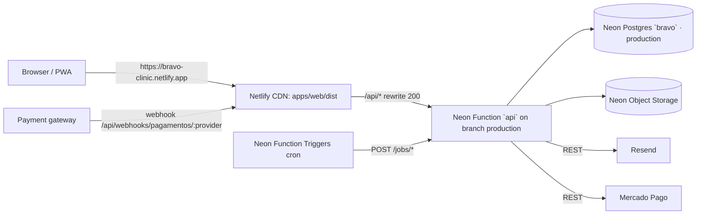

# Bravô Clinic · Global Technical Architecture

**Status**: Approved baseline for features `fundacao`, `nucleo`, `receita`, `gestao` (AD-013).
**Sources**: `docs/prd.md` (PRD v1.6), `.specs/STATE.md` (AD-001..AD-024), `docs/design/DESIGN.md`, `docs/design/home-reference.html`.
**Rule**: this file is the shared contract. A feature spec may refine it; it may not contradict it without a new `AD-NNN` entry in `.specs/STATE.md`.

---

## 1. Stack and versions

Workers MUST run `npm view <pkg>@<line> version` before installing and pin the newest patch of the line below. Do not jump major lines; the lines follow AD-002/AD-022.

| Area | Package | Line |
| --- | --- | --- |
| Runtime | Node.js | 24 (Neon Functions runtime; `.nvmrc` = `24`) |
| Language | `typescript` | `~5.9` |
| Lint/format | `eslint` `^9`, `typescript-eslint` `^8`, `eslint-plugin-react-hooks` `^5`, `prettier` `^3` | |
| Tests | `vitest` `^3.2`, `@vitest/coverage-v8` `^3.2`, `@testing-library/react` `^16`, `@testing-library/user-event` `^14`, `jsdom` `^26`, `@playwright/test` `^1` (nucleo smoke) | |
| Validation | `zod` | `^4` |
| API | `hono` `^4`, `@hono/node-server` `^1` (local dev only), `@hono/zod-validator` `^0.9` | |
| DB | `drizzle-orm` `^0.45`, `drizzle-kit` `^0.31`, `pg` `^8` | |
| Neon | `@neon/functions` `^0.11`, `@neon/config` `^1`, `@neon/env` `^1`, CLI `npx neonctl@latest` | |
| Auth | `jose` `^6`, `otpauth` `^9` | |
| Web | `react`/`react-dom` `^18.3`, `react-router-dom` `^6.30`, `@tanstack/react-query` `^5`, `react-hook-form` `^7`, `@hookform/resolvers` `^5`, `lucide-react` `^0.5xx`, `qrcode` `^1` (2FA QR) | |
| Build | `vite` `^7`, `@vitejs/plugin-react` `^5`, `vite-plugin-pwa` `^1`, `tailwindcss` `^3.4`, `postcss` `^8`, `autoprefixer` `^10` | |
| Later features | `@modelcontextprotocol/sdk` `^1`, `@hono/mcp` `^0.3`, `web-push` `^3`, `@aws-sdk/client-s3` `^3`, `exceljs` `^4` | |

---

## 2. Repository layout

```
/
├── package.json              # npm workspaces + root scripts (typecheck, lint, test, build, db:*)
├── tsconfig.base.json        # strict compiler options shared by all workspaces
├── eslint.config.js          # flat config for all workspaces
├── .prettierrc.json
├── .nvmrc                    # 24
├── .env.example              # variable NAMES only (see §10)
├── neon.ts                   # Neon IaC: function `api`, triggers (nucleo+), buckets (gestao)
├── netlify.toml              # web build + headers
├── scripts/
│   └── smoke.mjs             # production smoke check (fundacao T77)
├── .github/workflows/ci.yml
├── packages/
│   └── core/                 # @bravo/core — pure domain logic, zero I/O
│       ├── package.json      # "exports": { ".": "./src/index.ts" } (source-first, no build step)
│       └── src/
│           ├── index.ts      # re-exports public API only
│           ├── money.ts
│           ├── time.ts
│           ├── access.ts               # roles + admin/app navigation maps
│           ├── labels.ts               # pt-BR labels for every status code (nucleo+)
│           ├── settings/catalog.ts     # typed settings + factory defaults
│           ├── validation/document.ts  # CPF/CNPJ
│           ├── validation/auth-schemas.ts
│           ├── calendar/holidays-seed.ts
│           ├── calendar/day-type.ts    # nucleo
│           ├── slots/grid.ts           # nucleo
│           ├── pricing/categories.ts   # nucleo
│           ├── pricing/price.ts        # nucleo
│           ├── pricing/discounts.ts    # receita
│           ├── payments/split.ts       # nucleo
│           ├── policy/cancellation.ts  # nucleo
│           ├── policy/reschedule.ts    # nucleo
│           ├── status/booking.ts       # nucleo
│           ├── status/subscription.ts  # receita
│           ├── packages/debit.ts       # receita
│           ├── packages/conversion.ts  # receita
│           ├── packages/compensation.ts# receita
│           └── fixed/occurrences.ts    # receita
├── apps/
│   ├── api/                  # @bravo/api — Hono app (Neon Function slug `api`)
│   │   ├── package.json
│   │   ├── drizzle.config.ts
│   │   ├── drizzle/          # generated + custom SQL migrations, meta/_journal.json
│   │   ├── vitest.config.ts
│   │   ├── test/             # harness: migrate + truncate helpers, factories
│   │   └── src/
│   │       ├── index.ts      # `export default app` (Neon entry)
│   │       ├── dev.ts        # @hono/node-server on :8787 (local only)
│   │       ├── app.ts        # createApp(): middleware chain + route mounting
│   │       ├── env.ts        # zod-parsed env
│   │       ├── db/client.ts  # pg Pool(max 5) + attachDatabasePool + drizzle + withTransaction
│   │       ├── db/schema/    # one file per domain: identity, calendar, platform, booking,
│   │       │                 #   payments, subscriptions, ledgers, coupons, finance, extras, integrations
│   │       ├── db/migrate.ts # drizzle migrator against DATABASE_URL_UNPOOLED
│   │       ├── db/seed.ts    # idempotent seeds
│   │       ├── lib/          # errors, audit, crypto, email, logger, ics, idempotency
│   │       ├── middleware/   # request-context, auth, csrf, rate-limit
│   │       ├── auth/         # session, totp, google
│   │       ├── modules/<domain>/   # <domain>.service.ts (+ <domain>.repo.ts when queries are reused)
│   │       ├── payments/     # gateway.ts (interface), adapters/sandbox.ts, adapters/mercadopago.ts
│   │       ├── jobs/         # one file per job, registered in routes/jobs.ts
│   │       ├── mcp/          # server.ts, tools/*.ts
│   │       ├── emails/       # templates/*.ts (pt-BR)
│   │       └── routes/
│   │           ├── health.ts
│   │           ├── public/   # unauthenticated: auth/*, config, rooms, availability, catalog
│   │           ├── app/      # authenticated (any role): me, auth/*, bookings, purchases
│   │           ├── admin/    # staff only (+MFA)
│   │           ├── webhooks/ # pagamentos/:provider
│   │           ├── jobs.ts   # trigger-only
│   │           └── mcp.ts
│   └── web/                  # @bravo/web — Vite SPA (site + PWA + Admin)
│       ├── index.html        # static SEO: JSON-LD LocalBusiness + Open Graph
│       ├── tailwind.config.ts
│       ├── vite.config.ts
│       ├── scripts/write-redirects.mjs   # generates dist/_redirects (AD-016)
│       ├── public/           # icons, og-image.jpg, robots.txt, sitemap.xml, room-placeholder.webp
│       └── src/
│           ├── main.tsx
│           ├── router.tsx
│           ├── styles/tokens.css   # Day/Night CSS variables
│           ├── styles/index.css    # @tailwind layers + base
│           ├── theme/              # ThemeProvider, ThemeToggle
│           ├── lib/                # api.ts, query-client.ts
│           ├── components/ui/      # design-system primitives (§9.5)
│           ├── components/layout/  # PublicLayout, Header, Footer, WhatsAppButton, AppShell, AdminShell
│           ├── features/<domain>/  # hooks + domain components (auth, rooms, booking, purchases, admin-*)
│           └── pages/{public,app,admin,auth}/
```

### 2.1 Module boundaries

- `packages/core` imports only `zod`. ESLint `no-restricted-imports` forbids `pg`, `drizzle-orm`, `hono`, `react*`, `node:*` and any `fetch` usage under `packages/core/src`. Every function is deterministic: "now" is a parameter, never `Date.now()`.
- `apps/api` imports `@bravo/core`. Routes stay thin: parse (zod) → call a `modules/<domain>` service → serialize. Services own transactions and call `audit()`. Only services touch `db`.
- `apps/web` imports `@bravo/core` (pricing preview, schemas, labels, formatting). It never imports from `apps/api`; API types are declared in `features/<domain>/types.ts` from the documented JSON contract.
- Cross-domain calls inside the API go service → service, never route → route.

### 2.2 Naming conventions

| Thing | Convention | Example |
| --- | --- | --- |
| Files (TS) | kebab-case | `booking.service.ts`, `rate-limit.ts` |
| React components | PascalCase file + named export | `RoomCard.tsx` → `export function RoomCard` |
| Unit tests | `*.test.ts(x)` next to source | `money.test.ts` |
| Integration tests (API + DB) | `*.int.test.ts` | `signup.int.test.ts` |
| DB tables/columns | snake_case, plural tables | `booking_segments.rate_cents_per_hour` |
| Money columns | integer cents, suffix `_cents` | `total_cents` |
| Minute columns | integer, suffix `_minutes` / `_minute` (minute of local day) | `cleanup_minutes`, `start_minute` |
| Instants | `timestamptz`, suffix `_at` | `starts_at` |
| Local calendar dates | `date` (America/Sao_Paulo calendar day), suffix `_on` or `date` | `base_on`, `date` |
| Enumerations | `text` + `CHECK`, English snake_case codes (AD-017) | `status = 'awaiting_payment'` |
| JSON fields (API) | camelCase | `totalCents`, `startsAt` |
| API paths | English, kebab-case | `/api/app/bookings/:id/reschedule` |
| Web URLs | pt-BR, kebab-case | `/app/minhas-reservas` |
| Settings keys | dotted lower snake | `payment.deposit_percent` |
| Audit actions | `<entity>.<verb>` | `booking.confirm_manual` |
| Error codes | UPPER_SNAKE | `SLOT_TAKEN` |

---

## 3. Status machines and labels (PRD §7.5)

Codes are stored; pt-BR labels live in `packages/core/src/labels.ts`.

### 3.1 Booking (`bookings.status`)

| Code | pt-BR label | Meaning |
| --- | --- | --- |
| `awaiting_payment` | Aguardando pgto | in checkout or charge issued, unpaid; holds the slot until `hold_expires_at` |
| `pre_reserved` | Pré-reserva | created by staff for a given customer; holds until `hold_expires_at` |
| `held_for_renewal` | Pré-reservada (renovação) | next-period fixed-schedule occurrence (AD-023) |
| `confirmed` | Confirmada | deposit paid, package debited, subscription active, or manual confirmation |
| `paid` | Quitada | total paid |
| `completed` | Concluída | checked in (`checked_in_at` set) and ended |
| `no_show` | No-show | no check-in `policy.no_show_after_minutes` after start |
| `expired` | Expirada | checkout or pre-reservation not confirmed in time |
| `cancelled_by_tenant` | Cancelada pelo locatário | |
| `cancelled_nonpayment` | Cancelada por falta de pagamento | balance not paid by deadline |
| `cancelled_by_clinic` | Cancelada pela clínica | |

Allowed transitions (`packages/core/src/status/booking.ts`, enforced by services with `UPDATE ... WHERE status = <from>`):

```
awaiting_payment → confirmed | paid | expired | cancelled_by_tenant
pre_reserved     → confirmed | paid | expired | cancelled_by_clinic
held_for_renewal → confirmed | cancelled_by_clinic | expired        (expired = renewal failed / not renewed)
confirmed        → paid | completed | no_show | cancelled_by_tenant | cancelled_nonpayment | cancelled_by_clinic
paid             → completed | no_show | cancelled_by_tenant | cancelled_by_clinic
```
Terminal: `completed`, `no_show`, `expired`, `cancelled_*`. Leaving a holding state to a terminal state sets `room_occupancy.active = false` in the same transaction. Package/subscription bookings go straight to `confirmed`; a booking with `balance_cents = 0` after payment goes to `paid`.

### 3.2 Subscription (`subscriptions.status`)

| Code | Label | |
| --- | --- | --- |
| `active` | Ativa | |
| `suspended` | Suspensa | renewal unpaid at base date; regularizable for `payment.renewal_grace_days` |
| `ended` | Encerrada | grace expired |
| `cancelled` | Cancelada | tenant/admin cancel, immediate |
| `switched` | Trocada | replaced by `switched_to_subscription_id` on the switch date |

```
active → active (renewal paid) | suspended | cancelled | switched
suspended → active | ended | cancelled
```

### 3.3 Other machines

- `charges.status`: `pending → approved | rejected | cancelled | expired`; `approved → refunded | partially_refunded | charged_back`; `partially_refunded → refunded`.
- `quote_requests.status`: `new → contacted → quote_sent → won | lost` (labels Novo, Em contato, Orçamento enviado, Fechado, Perdido); any non-terminal → `lost`.
- `email_outbox.status`: `pending → sent | failed`; `pending → not_sent` when no provider is configured (AD-008).

---

## 4. Settings catalog (typed, factory defaults)

Stored in table `settings(key, value jsonb)`. The single source of keys, zod schemas and defaults is `packages/core/src/settings/catalog.ts`:

```ts
export const settingsCatalog = {
  'calendar.slot_minutes': { schema: z.number().int().refine(v => [5,10,15,20,30,60].includes(v)), default: 30 },
  // ...
} as const satisfies Record<string, { schema: z.ZodType; default: unknown; scope: SettingScope }>;
export type SettingKey = keyof typeof settingsCatalog;
export type SettingValue<K extends SettingKey> = z.infer<(typeof settingsCatalog)[K]['schema']>;
export function parseSetting<K extends SettingKey>(key: K, value: unknown): SettingValue<K>; // throws SettingValidationError
export function settingDefaults(): { [K in SettingKey]: SettingValue<K> };
```

Seeds insert every key with its default; seeds never overwrite an existing row. Changing a policy key increments `policy.version` (nucleo) so checkout text and frozen `policy_snapshot` stay consistent (US-15).

| Key | Type / bounds | Default | PRD |
| --- | --- | --- | --- |
| `calendar.slot_minutes` | int ∈ {5,10,15,20,30,60} | `30` | §5.2 |
| `calendar.default_booking_minutes` | int 15..480, multiple of slot | `60` (also the minimum duration) | §5.2 |
| `calendar.cleanup_minutes` | int 0..240 | `30` | §5.2.1 |
| `calendar.min_advance_minutes` | int 0..10080 | `0` | §7.3.1 |
| `calendar.max_advance_days` | int 1..365 | `90` | §5.2 |
| `calendar.holiday_review_reminder` | `{ month: 1..12, day: 1..31 }` | `{ "month": 10, "day": 1 }` | §5.2 |
| `payment.active_gateway` | `'sandbox' \| 'mercadopago'` | `'sandbox'` | §8, AD-006 |
| `payment.deposit_percent` | int 0..100 | `50` | §5.4 |
| `payment.deposit_refundable` | boolean | `false` | §5.4 |
| `payment.balance_charge_hours_before` | int 1..720 | `48` | §5.4 |
| `payment.balance_deadline_hours_before` | int 1..720, < charge hours | `24` | §5.4 |
| `payment.balance_reminder_hours_before` | int[] (desc, each between deadline and charge) | `[48, 36, 26]` | §5.4 |
| `payment.full_upfront_threshold_hours` | int 0..720 | `48` | §5.4 |
| `payment.checkout_hold_minutes` | int 5..120 | `15` | §5.4 |
| `payment.pre_reservation_expiry_hours` | int 1..720 | `24` | §5.4 |
| `payment.subscription_renewal_days_before` | int 0..30 | `2` | §5.4 |
| `payment.renewal_grace_days` | int 0..60 | `7` | §5.4 |
| `payment.extra_hours_min` / `payment.extra_hours_max` | int 1..100 | `1` / `20` | §5.3.1 |
| `payment.extra_hours_validity_days` | int 1..365 | `90` | §5.4 |
| `payment.closed_day_compensation_enabled` | boolean | `true` (divisor = period length in days: 30/60/90) | §5.4 |
| `credits.validity_days` | int 1..730 | `90` | §5.3.5 |
| `policy.reschedule_free_count` | int 0..10 | `1` | §5.5 |
| `policy.reschedule_min_hours_before` | int 0..720 | `24` | §5.5 |
| `policy.reschedule_window_days` | int 1..365 | `60` | §5.5 |
| `policy.cancel_refund_min_hours_before` | int 0..720 | `24` | §5.5 |
| `policy.package_cancel_return_min_hours_before` | int 0..720 | `24` | §5.5 |
| `policy.no_show_after_minutes` | int 5..240 | `30` | US-13 |
| `policy.clinic_cancel_options` | subset of `['refund','minutes','credit']` | `["refund","minutes","credit"]` | §5.5 |
| `policy.version` | int ≥ 1 (system-managed) | `1` | US-15 |
| `clinic.whatsapp_e164` | string `^\+?\d{12,13}$` or `""` | `""` (button links to `https://wa.me/`) | §7.1 |
| `clinic.contact_email` | email or `""` | `""` | §7.1 |
| `clinic.address_line` | string ≤ 200 | `"Praia Brava, Itajaí – SC"` | §1 |
| `onboarding.prices_reviewed` | boolean | `false` | US-12 |
| `notifications.events` | record of booleans | all `true`: `new_booking, payment_received, booking_cancelled, new_subscription, renewal_failed, pre_reservation_expired, new_quote_request` | §7.3.4 |
| `mcp.enabled` | boolean | `false` | §7.3.4 |
| `mcp.rate_limit_per_minute` | int 1..600 | `60` | §8 |

Timezone is not a setting: `America/Sao_Paulo` is a constant in `core/time.ts` (PRD §5.2 "fuso horário único").

---

## 5. Data model (Postgres 17, complete MVP)

### 5.1 Global conventions

- PKs `uuid default gen_random_uuid()` except append-only ledgers/logs (`bigint generated always as identity`).
- Every table has `created_at timestamptz not null default now()`; mutable tables add `updated_at timestamptz not null default now()` (set by services).
- FKs `on delete restrict` unless noted. Users are never hard-deleted: LGPD deletion anonymizes (`users.status = 'deleted'`, PII nulled, `deleted_at`).
- Append-only tables (`audit_log`, `booking_events`, `package_ledger`, `extra_minutes_ledger`, `credit_ledger`, `coupon_uses` after consumption, `consents`) get trigger `forbid_update_delete()` that raises `append_only_table`. Corrections are compensating rows.
- Migrations: drizzle-kit generates DDL from `apps/api/src/db/schema/*.ts`; constraints Drizzle cannot express (extensions, `EXCLUDE`, triggers, partial unique indexes on expressions) go in custom migrations created with `drizzle-kit generate --custom --name=<name>`. Each feature appends its own migrations; numbering is assigned by drizzle-kit at implementation time (features run in the order fundacao → nucleo → receita → gestao; a feature rebases and regenerates if another landed first).

| Feature | Migration(s) | Creates |
| --- | --- | --- |
| fundacao | `0000_base`, `0001_base_constraints` | §5.2 |
| nucleo | `<n>_nucleo`, `<n>_nucleo_constraints` | §5.3 |
| receita | `<n>_receita`, `<n>_receita_constraints` | §5.4 |
| gestao | `<n>_gestao` | §5.5 |

### 5.2 Base (fundacao)

```text
users
  id uuid pk
  role text not null check (role in ('tenant','reception','admin')) default 'tenant'
  status text not null check (status in ('active','disabled','deleted')) default 'active'
  name text not null                       -- 2..120 chars
  email text not null                      -- stored lower-cased
  email_verified_at timestamptz
  password_hash text                       -- null for Google-only accounts; format scrypt$N$r$p$salt$hash
  google_sub text
  doc_type text check (doc_type in ('cpf','cnpj'))
  doc_number text                          -- digits only (11 or 14)
  phone text                               -- E.164, e.g. +5547999990000
  profession text                          -- ≤ 80
  professional_registry text               -- ≤ 40, informative
  notes text                               -- staff observations (Clientes screen)
  last_login_at timestamptz
  deleted_at timestamptz
  created_at, updated_at
  unique index users_email_uq on (email)
  unique index users_google_sub_uq on (google_sub) where google_sub is not null
  unique index users_doc_uq on (doc_number) where doc_number is not null
  check ((doc_type is null) = (doc_number is null))      -- staff and Google sign-ups may have no document yet;
                                                          -- booking requires one (nucleo service check)

sessions
  id uuid pk
  user_id uuid not null fk users on delete cascade
  mfa_verified_at timestamptz             -- null = password-only session
  expires_at timestamptz not null
  revoked_at timestamptz
  ip inet, user_agent text
  created_at, last_seen_at timestamptz
  index (user_id) where revoked_at is null

auth_tokens                               -- email verification + password reset
  id uuid pk
  user_id uuid not null fk users on delete cascade
  purpose text not null check (purpose in ('email_verify','password_reset'))
  token_hash text not null                -- sha256 hex of the random token; raw token only in the e-mail
  expires_at timestamptz not null
  used_at timestamptz
  created_at
  unique index (token_hash)
  index (user_id, purpose, created_at)

user_totp
  user_id uuid pk fk users on delete cascade
  secret_ciphertext text not null         -- AES-256-GCM, base64(iv|tag|ct), key ENCRYPTION_KEY
  confirmed_at timestamptz
  last_used_step bigint                   -- replay protection
  recovery_code_hashes text[] not null default '{}'   -- sha256 of 10 one-time codes; used ones removed
  created_at, updated_at

consents                                  -- append-only (LGPD §8)
  id uuid pk
  user_id uuid fk users
  kind text not null check (kind in ('terms','privacy','booking_policy','subscription_terms','recurring_charge'))
  version text not null                   -- e.g. 'terms-2026-10', 'policy-v3'
  accepted_at timestamptz not null default now()
  ip inet, user_agent text
  ref_type text, ref_id uuid              -- e.g. ('booking', id) for policy acceptance at checkout
  index (user_id, kind)

rate_limit_buckets                        -- fixed-window counters (auth, MCP)
  key text not null                       -- e.g. 'login:email:<sha256>', 'mcp:token:<id>'
  window_start timestamptz not null
  count integer not null default 0
  primary key (key, window_start)

rooms
  id uuid pk
  slug text not null unique               -- 'principal','secundaria','terceira'
  name text not null
  description text not null default ''
  ideal_for text[] not null default '{}'
  equipment text[] not null default '{}'
  status text not null check (status in ('active','inactive')) default 'active'
  display_order integer not null default 0
  created_at, updated_at

room_photos
  id uuid pk
  room_id uuid not null fk rooms on delete cascade
  storage_key text not null               -- Neon Object Storage key (AD-009)
  alt text not null default ''
  width integer, height integer
  is_cover boolean not null default false
  display_order integer not null default 0
  created_at
  unique index (room_id) where is_cover

settings
  key text pk                             -- catalog key (§4)
  value jsonb not null
  updated_at timestamptz not null default now()
  updated_by uuid fk users

business_hours
  day_type text pk check (day_type in ('mon','tue','wed','thu','fri','sat','sun','holiday'))
  is_closed boolean not null default false
  open_minute smallint not null           -- minute of local day, 0..1439
  close_minute smallint not null          -- 1..1440 (1440 = 00:00 of the next day)
  updated_at, updated_by uuid fk users
  check (close_minute > open_minute and open_minute >= 0 and close_minute <= 1440)

holidays
  id uuid pk
  date date not null
  name text not null
  scope text not null check (scope in ('national','state','municipal','optional'))
  source text not null check (source in ('seed','brasilapi','manual'))
  is_closed boolean not null default false   -- default: open with holiday rules (§5.2)
  needs_review boolean not null default false
  created_at, updated_at
  unique (date, name)
  index (date)

closed_days
  id uuid pk
  date date not null
  room_id uuid fk rooms                   -- null = whole clinic
  reason text
  created_by uuid fk users
  created_at
  unique index closed_days_uq on (date, coalesce(room_id, '00000000-0000-0000-0000-000000000000'))

block_recurrences
  id uuid pk
  room_id uuid not null fk rooms
  tag text not null                       -- 'Limpeza' | 'Indisponível' | free text ≤ 60
  weekdays smallint[] not null            -- ISO 1=Mon..7=Sun
  start_minute smallint not null, end_minute smallint not null
  valid_from date not null, valid_until date
  active boolean not null default true
  created_by uuid fk users, created_at, updated_at
  check (end_minute > start_minute)

blocks
  id uuid pk
  room_id uuid not null fk rooms
  tag text not null
  starts_at timestamptz not null, ends_at timestamptz not null
  recurrence_id uuid fk block_recurrences   -- materialized occurrence of a rule
  cancelled_at timestamptz
  created_by uuid fk users, created_at
  check (ends_at > starts_at)
  index (room_id, starts_at)
  unique (recurrence_id, starts_at)

room_occupancy                            -- the double-booking guard (AD-004)
  id uuid pk
  room_id uuid not null fk rooms
  period tstzrange not null               -- booking: [starts_at, ends_at + cleanup_minutes); block: [starts_at, ends_at)
  kind text not null check (kind in ('booking','block'))
  ref_id uuid not null                    -- bookings.id or blocks.id
  active boolean not null default true
  created_at, updated_at
  check (not isempty(period) and lower_inc(period) and not upper_inc(period))
  constraint room_occupancy_no_overlap exclude using gist (room_id with =, period with &&) where (active)
  unique index (kind, ref_id) where active
  index using gist (period) where active  -- availability window scans

audit_log                                 -- append-only
  id bigint identity pk
  at timestamptz not null default now()
  actor_user_id uuid fk users
  actor_role text                         -- role at the time of the action
  origin text not null check (origin in ('web','app','admin','mcp','job','system'))
  action text not null                    -- '<entity>.<verb>'
  entity_type text not null, entity_id text
  justification text
  before jsonb, after jsonb
  ip inet, request_id text
  index (entity_type, entity_id), index (at desc), index (actor_user_id, at desc)

email_outbox
  id uuid pk
  to_address text not null
  template text not null                  -- 'auth.verify_email', 'booking.confirmed', ...
  subject text not null
  html text not null, text_body text not null
  attachments jsonb not null default '[]' -- [{ filename, contentType, contentBase64 }] (.ics)
  status text not null check (status in ('pending','sent','failed','not_sent')) default 'pending'
  provider_message_id text
  attempts integer not null default 0
  last_error text
  dedupe_key text                         -- e.g. 'balance_reminder:<bookingId>:36'
  created_at, sent_at timestamptz
  unique index (dedupe_key) where dedupe_key is not null
  index (status, created_at)

integration_settings
  key text pk                             -- 'gateway.mercadopago' | 'gateway.sandbox' | 'email.resend' | 'push.vapid'
  enabled boolean not null default false
  environment text check (environment in ('test','production'))
  config jsonb not null default '{}'      -- non-secret fields only
  secret_ciphertext text                  -- AES-256-GCM JSON of secret fields
  secret_hint text                        -- e.g. '••••a1b2'; never the whole secret
  updated_at, updated_by uuid fk users
```

### 5.3 Booking core (nucleo)

```text
booking_categories                        -- all four types (§5.3); seeded with the 8 factory categories
  id uuid pk
  name text not null
  type text not null check (type in ('hourly','block','hour_package','fixed_schedule'))
  weekdays smallint[] not null default '{1,2,3,4,5,6,7}'   -- ISO weekdays where it applies
  applies_on_holidays boolean not null default true
  start_minute smallint not null default 0, end_minute smallint not null default 1440
  weekday_rate_cents integer              -- hourly: Mon–Fri rate per hour
  weekend_rate_cents integer              -- hourly: Sat/Sun/holiday rate per hour
  min_duration_minutes integer            -- hourly; default 60
  fixed_price_cents integer               -- block, hour_package
  price_per_occurrence_cents integer      -- fixed_schedule
  included_minutes integer                -- hour_package
  period text not null check (period in ('single','monthly','bimonthly','quarterly'))
  is_reference boolean not null default false   -- V_ref category
  status text not null check (status in ('active','inactive')) default 'active'
  visibility text not null check (visibility in ('public','admin_only')) default 'public'
  room_id uuid fk rooms                   -- null = all rooms (per-room pricing reserved for future)
  display_order integer not null default 0
  version integer not null default 1      -- bumps on price edits (renewal notices)
  created_at, updated_at
  check (type <> 'hourly' or (weekday_rate_cents is not null and weekend_rate_cents is not null and min_duration_minutes is not null and period = 'single'))
  check (type <> 'block' or (fixed_price_cents is not null and period = 'single'))
  check (type <> 'hour_package' or (fixed_price_cents is not null and included_minutes > 0 and period <> 'single'))
  check (type <> 'fixed_schedule' or (price_per_occurrence_cents is not null and period <> 'single'))
  unique index (is_reference) where is_reference
  check (not is_reference or type = 'hourly')

bookings
  id uuid pk
  code text not null unique               -- 'BRV-' + 6 base32 chars, shown to customers
  user_id uuid not null fk users
  room_id uuid not null fk rooms
  kind text not null check (kind in ('single','fixed_occurrence')) default 'single'
  status text not null                    -- §3.1 codes (check constraint lists them)
  source text not null check (source in ('web','app','admin','mcp'))
  created_by_user_id uuid fk users
  starts_at timestamptz not null, ends_at timestamptz not null
  cleanup_minutes integer not null        -- frozen at creation (§8)
  duration_minutes integer not null
  payment_mode text not null check (payment_mode in ('deposit_balance','full_upfront','package','subscription','manual'))
  gross_cents integer not null default 0  -- sum of segments
  discount_cents integer not null default 0
  discount_source text not null check (discount_source in ('none','coupon','slot_discount')) default 'none'
  total_cents integer not null default 0  -- gross - discount (frozen)
  deposit_cents integer not null default 0
  balance_cents integer not null default 0
  paid_cents integer not null default 0   -- cached sum of approved charges + credits applied
  credit_applied_cents integer not null default 0
  balance_charge_at timestamptz, balance_due_at timestamptz
  hold_expires_at timestamptz             -- awaiting_payment / pre_reserved / held_for_renewal
  policy_snapshot jsonb not null          -- §5.4/§5.5 values at creation + policy.version
  reschedule_count integer not null default 0
  checked_in_at timestamptz
  cancelled_at timestamptz, cancel_reason text, cancelled_by uuid fk users
  confirmed_manually_by uuid fk users
  ics_uid text not null unique, ics_sequence integer not null default 0   -- RFC 5545
  notes text
  created_at, updated_at
  check (ends_at > starts_at)
  index (user_id, starts_at desc), index (room_id, starts_at), index (status, hold_expires_at), index (status, balance_charge_at)

booking_segments                          -- per-category pricing breakdown, frozen
  id uuid pk
  booking_id uuid not null fk bookings on delete cascade
  seq smallint not null
  starts_at timestamptz not null, ends_at timestamptz not null
  category_id uuid fk booking_categories
  category_name text not null             -- frozen label
  day_type text not null check (day_type in ('weekday','weekend_holiday'))
  rate_cents_per_hour integer             -- V_slot (hourly); null for block price
  minutes integer not null
  amount_cents integer not null
  unique (booking_id, seq)

booking_events                            -- append-only status history
  id bigint identity pk
  booking_id uuid not null fk bookings
  from_status text, to_status text not null
  at timestamptz not null default now()
  actor_user_id uuid fk users, origin text not null
  reason text, data jsonb

idempotency_keys
  user_id uuid not null fk users
  key text not null                       -- client Idempotency-Key header (≤ 100 chars)
  route text not null
  request_hash text not null              -- sha256 of canonical JSON body
  response_status integer, response_body jsonb
  created_at, expires_at timestamptz not null   -- created + 24h
  primary key (user_id, key)

payment_customers
  user_id uuid not null fk users, provider text not null
  external_customer_id text not null, created_at
  primary key (user_id, provider)

saved_cards
  id uuid pk
  user_id uuid not null fk users, provider text not null
  external_card_id text not null, brand text, last4 char(4), exp_month smallint, exp_year smallint
  recurring_consent_at timestamptz         -- explicit consent for recurring charges (§8)
  created_at, deleted_at timestamptz
  unique (provider, external_card_id)

charges                                   -- provider-agnostic charge attempts (§8)
  id uuid pk
  provider text not null                  -- 'sandbox' | 'mercadopago' | 'internal' (credits/manual)
  external_id text                        -- provider payment id
  purpose text not null check (purpose in ('booking_deposit','booking_balance','booking_full','booking_difference',
           'subscription_initial','subscription_renewal','extra_hours','extra_service'))
  method text not null check (method in ('pix','card','saved_card','credit'))
  user_id uuid not null fk users
  booking_id uuid fk bookings
  amount_cents integer not null check (amount_cents > 0)
  fee_cents integer not null default 0    -- gateway fee (DRE line 4)
  status text not null                    -- §3.3
  pix_qr_code text, pix_copy_paste text, checkout_url text
  expires_at timestamptz, approved_at timestamptz
  refunded_cents integer not null default 0
  idempotency_key text not null unique
  raw_last jsonb                          -- last normalized provider payload (no card data)
  created_at, updated_at
  unique index (provider, external_id) where external_id is not null
  index (status, created_at), index (booking_id)
  -- receita adds: subscription_period_id fk, extra_hours_purchase_id fk

refunds
  id uuid pk
  charge_id uuid not null fk charges
  provider text not null, external_id text
  amount_cents integer not null check (amount_cents > 0)
  reason text not null                    -- 'tenant_cancel' | 'clinic_cancel' | 'late_approval_conflict' | 'manual'
  status text not null check (status in ('pending','approved','failed'))
  requested_by uuid fk users, created_at, completed_at timestamptz

webhook_events
  id uuid pk
  provider text not null, external_id text not null, external_status text not null
  signature_valid boolean not null
  payload jsonb not null
  received_at timestamptz not null default now(), processed_at timestamptz, error text
  unique (provider, external_id, external_status)          -- AD-006 idempotency

job_runs
  id bigint identity pk
  job text not null, invocation_id text
  started_at timestamptz not null default now(), finished_at timestamptz
  status text not null check (status in ('running','ok','error'))
  stats jsonb, error text
  index (job, started_at desc)
```

### 5.4 Revenue (receita)

```text
subscriptions
  id uuid pk
  user_id uuid not null fk users
  category_id uuid not null fk booking_categories
  type text not null check (type in ('hour_package','fixed_schedule'))
  room_id uuid fk rooms                   -- fixed_schedule only
  status text not null                    -- §3.2
  base_on date not null                   -- current base date (new on switch)
  period_days smallint not null check (period_days in (30,60,90))
  price_snapshot jsonb not null           -- { priceCents | pricePerOccurrenceCents, includedMinutes, vPacNum, vPacDen, weekdays, startMinute, endMinute, categoryVersion }
  payment_method text not null check (payment_method in ('saved_card','pix'))
  saved_card_id uuid fk saved_cards
  first_coupon_id uuid fk coupons         -- applies to first payment only
  auto_renew boolean not null default true
  switched_to_subscription_id uuid fk subscriptions
  source text not null, created_by uuid fk users
  suspended_at, ended_at, cancelled_at timestamptz
  created_at, updated_at
  index (user_id, status), index (status, base_on)

subscription_periods
  id uuid pk
  subscription_id uuid not null fk subscriptions
  seq integer not null
  starts_on date not null, ends_on date not null          -- [starts_on, ends_on) local dates
  price_cents integer not null, discount_cents integer not null default 0
  occurrence_count integer                -- fixed_schedule
  included_minutes integer                -- hour_package
  minutes_balance integer                 -- hour_package cached balance (ledger sum)
  status text not null check (status in ('upcoming','awaiting_payment','paid','active','closed','failed'))
  charge_due_at timestamptz not null      -- starts_on - renewal_days_before (local midnight)
  paid_at timestamptz
  created_at, updated_at
  unique (subscription_id, seq)
  index (status, charge_due_at)

package_ledger                            -- append-only minute ledger of the period balance
  id bigint identity pk
  subscription_id uuid not null fk subscriptions, period_id uuid not null fk subscription_periods
  user_id uuid not null fk users
  entry_type text not null check (entry_type in ('period_grant','debit','refund','expiry','conversion_in','conversion_out','manual_adjustment'))
  minutes integer not null                -- signed
  booking_id uuid fk bookings
  detail jsonb                            -- debit formula inputs/outputs (extrato)
  created_by uuid fk users, created_at
  index (period_id), index (user_id, created_at desc)

extra_hours_purchases
  id uuid pk
  user_id uuid not null fk users, subscription_id uuid not null fk subscriptions
  hours smallint not null check (hours between 1 and 100)
  unit_price_cents integer not null        -- V_pac at purchase
  total_cents integer not null
  status text not null check (status in ('awaiting_payment','paid','cancelled'))
  created_at, paid_at

extra_minute_lots                          -- extra hours + closed-day compensation (both "horas extras")
  id uuid pk
  user_id uuid not null fk users
  source text not null check (source in ('purchase','closed_day_compensation','manual'))
  purchase_id uuid fk extra_hours_purchases
  minutes_granted integer not null, minutes_remaining integer not null check (minutes_remaining >= 0)
  expires_at timestamptz not null          -- purchase + 90 days
  created_at
  index (user_id, expires_at) where minutes_remaining > 0

extra_minutes_ledger                       -- append-only
  id bigint identity pk
  lot_id uuid not null fk extra_minute_lots, user_id uuid not null fk users
  entry_type text not null check (entry_type in ('grant','debit','refund','expiry','manual_adjustment'))
  minutes integer not null, booking_id uuid fk bookings, detail jsonb
  created_by uuid fk users, created_at

credit_lots
  id uuid pk
  user_id uuid not null fk users
  source text not null check (source in ('reschedule_difference','closed_day_compensation','manual','clinic_cancellation'))
  amount_cents integer not null, remaining_cents integer not null check (remaining_cents >= 0)
  expires_at timestamptz not null          -- + credits.validity_days
  ref_type text, ref_id uuid, justification text
  created_by uuid fk users, created_at
  index (user_id, expires_at) where remaining_cents > 0

credit_ledger                              -- append-only
  id bigint identity pk
  lot_id uuid not null fk credit_lots, user_id uuid not null fk users
  entry_type text not null check (entry_type in ('grant','use','refund','expiry','manual_adjustment'))
  amount_cents integer not null, booking_id uuid fk bookings, charge_id uuid fk charges
  created_by uuid fk users, created_at

coupons
  id uuid pk
  code text not null                       -- stored upper-case
  type text not null check (type in ('first_booking','discount'))
  discount_kind text not null check (discount_kind in ('percent','fixed'))
  discount_value integer not null          -- percent: basis points (1000 = 10%); fixed: cents
  applies_to text not null check (applies_to in ('bookings','packages','both'))   -- first_booking ⇒ 'bookings'
  max_uses integer                         -- null = unlimited
  uses_count integer not null default 0
  per_customer_limit integer
  valid_from timestamptz, valid_until timestamptz
  enabled boolean not null default true
  created_by uuid fk users, created_at, updated_at
  unique index (code)
  check (max_uses is null or uses_count <= max_uses)
  -- atomic consumption: UPDATE coupons SET uses_count = uses_count + 1
  --   WHERE id = $1 AND enabled AND (max_uses IS NULL OR uses_count < max_uses) RETURNING id

coupon_uses
  id uuid pk
  coupon_id uuid not null fk coupons, user_id uuid not null fk users
  doc_number text                          -- first-booking eligibility by CPF/CNPJ
  booking_id uuid fk bookings, subscription_id uuid fk subscriptions
  discount_cents integer not null
  status text not null check (status in ('reserved','consumed','released'))   -- reserved during checkout hold
  created_at, updated_at
  index (coupon_id), index (doc_number)

slot_discounts
  id uuid pk
  room_id uuid not null fk rooms
  period tstzrange not null
  percent smallint not null check (percent between 1 and 100)
  created_by uuid fk users, created_at
  removed_at timestamptz, consumed_by_booking_id uuid fk bookings
  constraint slot_discounts_no_overlap exclude using gist (room_id with =, period with &&) where (removed_at is null and consumed_by_booking_id is null)

closed_day_compensations
  id uuid pk
  closed_day_id uuid not null fk closed_days
  subscription_id uuid not null fk subscriptions, period_id uuid not null fk subscription_periods
  kind text not null check (kind in ('minutes','credit'))
  minutes integer, amount_cents integer
  extra_minute_lot_id uuid fk extra_minute_lots, credit_lot_id uuid fk credit_lots
  created_at
  unique (closed_day_id, subscription_id)

-- ALTERs in the receita migration
bookings  add coupon_id uuid fk coupons, subscription_id uuid fk subscriptions,
              subscription_period_id uuid fk subscription_periods,
              package_minutes_debited integer not null default 0,
              extra_minutes_debited integer not null default 0
charges   add subscription_period_id uuid fk subscription_periods,
              extra_hours_purchase_id uuid fk extra_hours_purchases
```

### 5.5 Management (gestao)

```text
expense_categories
  id uuid pk, name text not null unique, display_order integer not null, active boolean not null default true
  -- seeded: Aluguel, Condomínio e IPTU, Energia, Água, Internet, Limpeza e higienização, Manutenção,
  --         Materiais e insumos, Marketing, Pessoal, Contabilidade, Taxas do gateway, Impostos, Outros

expenses
  id uuid pk
  date date not null
  category_id uuid not null fk expense_categories
  description text not null
  amount_cents integer not null check (amount_cents > 0)
  recurrence text not null check (recurrence in ('none','monthly','quarterly','yearly')) default 'none'
  recurrence_parent_id uuid fk expenses
  attachment_key text                      -- Object Storage key
  created_by uuid fk users, created_at, updated_at, deleted_at
  index (date)

manual_receipts
  id uuid pk
  date date not null
  revenue_category text not null check (revenue_category in ('rental_single','subscription_initial','subscription_renewal','extra_hours','extra_services','other'))
  method text not null check (method in ('cash','card_machine','pix_direct'))
  amount_cents integer not null check (amount_cents > 0)
  description text, user_id uuid fk users, booking_id uuid fk bookings
  created_by uuid fk users, created_at, deleted_at
  index (date)

extra_services
  id uuid pk, name text not null, description text not null default ''
  reference_price_cents integer, unit text not null check (unit in ('hour','project'))
  sale_mode text not null check (sale_mode in ('quote','online')) default 'quote'
  status text not null check (status in ('active','inactive')) default 'active'
  display_order integer not null default 0, created_at, updated_at
  -- seeded: Pacote de filmagem (8000/hour), Videomaker, Marketing digital — all 'quote'

booking_extra_items                        -- online-sold extras added at checkout
  id uuid pk, booking_id uuid not null fk bookings, service_id uuid not null fk extra_services
  quantity integer not null check (quantity > 0), unit_price_cents integer not null, amount_cents integer not null

quote_requests
  id uuid pk
  service_id uuid not null fk extra_services
  user_id uuid fk users, booking_id uuid fk bookings
  name text not null, email text, phone text not null
  description text not null, desired_on date
  status text not null default 'new'       -- §3.3
  staff_notes text, created_at, updated_at
  index (status, created_at desc)

notification_recipients
  id uuid pk, email text not null unique, active boolean not null default true, created_at

push_subscriptions
  id uuid pk, user_id uuid not null fk users on delete cascade
  endpoint text not null unique, p256dh text not null, auth text not null, user_agent text
  created_at, last_success_at timestamptz, failure_count integer not null default 0

ics_feed_tokens
  id uuid pk
  scope text not null check (scope in ('user','clinic','room'))
  user_id uuid fk users, room_id uuid fk rooms
  token_hash text not null unique, token_prefix text not null      -- first 6 chars for display
  created_by uuid fk users, created_at, revoked_at timestamptz, last_accessed_at timestamptz
  unique index (user_id) where scope = 'user' and revoked_at is null

mcp_tokens
  id uuid pk
  name text not null                       -- device label
  owner_user_id uuid not null fk users     -- admin who created it
  scope text not null check (scope in ('read','read_write'))
  token_hash text not null unique, token_prefix text not null
  created_at, last_used_at timestamptz, revoked_at timestamptz, expires_at timestamptz
```

Read-model note (gestao): the free-tier usage panel computes `pg_database_size(current_database())`, row counts and object-storage bytes on request; nothing is stored.

---

## 6. API conventions

### 6.1 Paths and prefixes (AD-015)

The Hono app serves **native** paths without `/api`. Netlify rewrites `/api/*` → `<function-url>/:splat`; Vite dev server proxies `/api` → `http://localhost:8787` with the prefix stripped. Docs and the browser use the public form.

| Public prefix | Native | Auth | Purpose |
| --- | --- | --- | --- |
| `/api/health` | `/health` | none | liveness + DB check |
| `/api/public/*` | `/public/*` | none (rate-limited where noted) | auth flows, config, rooms, availability, catalog, quote requests, pre-reservation links |
| `/api/app/*` | `/app/*` | session (any role) | me, bookings, purchases, profile, ICS link, push subscription |
| `/api/admin/*` | `/admin/*` | role `admin` or `reception` + MFA verified; admin-only routes add `requireRole('admin')` | all Admin screens |
| `/api/webhooks/*` | `/webhooks/*` | provider signature | `/webhooks/pagamentos/:provider` |
| `/api/jobs/*` | `/jobs/*` | `parseTriggerDelivery` only (never session) | cron jobs (AD-007) |
| `/api/mcp` | `/mcp` | bearer MCP token | MCP streamable HTTP (AD-011) |
| `/api/ics/:token.ics` | `/ics/:token.ics` | secret token in URL | ICS feeds (gestao) |

Long-lived streams do not go through the Netlify proxy (it cuts responses after ~26 s): Integrações shows MCP clients the native function URL (`<invocation_url>/mcp`), authenticated by the MCP bearer token (gestao).

Reception may call: Gestão de Reservas routes (create booking/pre-reservation, check-in, blocks, list) and Clientes. Everything else under `/admin` is admin-only. The source of truth for screen access is `packages/core/src/access.ts`.

### 6.2 Request/response format

- JSON only. Mutations require `Content-Type: application/json` (415 otherwise).
- Success: the resource object, or `{ "items": [...], "nextCursor": "<opaque>" | null }` for lists (cursor = base64 of `(created_at,id)`; page size ≤ 100, default 50).
- Money as integer cents (`totalCents`). Instants as ISO-8601 UTC strings. Local dates as `YYYY-MM-DD`. Minute of day as integers.
- Error envelope (every non-2xx):

```json
{ "error": { "code": "VALIDATION_FAILED", "message": "Dados inválidos", "details": [{ "path": "document", "message": "CPF ou CNPJ inválido" }], "requestId": "01J..." } }
```

| HTTP | Codes |
| --- | --- |
| 400 | `INVALID_TOKEN`, `INVALID_STATE`, `BAD_REQUEST` |
| 401 | `UNAUTHENTICATED`, `INVALID_CREDENTIALS`, `INVALID_CODE` |
| 403 | `FORBIDDEN`, `MFA_REQUIRED`, `MFA_ENROLLMENT_REQUIRED`, `CSRF_REJECTED`, `EMAIL_NOT_VERIFIED` |
| 404 | `NOT_FOUND`, `FEATURE_DISABLED` |
| 409 | `EMAIL_TAKEN`, `DOCUMENT_TAKEN`, `SLOT_TAKEN` (SQLSTATE 23P01), `INVALID_TRANSITION`, `COUPON_EXHAUSTED`, `CONFLICT` |
| 415 | `UNSUPPORTED_MEDIA_TYPE` |
| 422 | `VALIDATION_FAILED`, `POLICY_VIOLATION`, `INSUFFICIENT_BALANCE`, `IDEMPOTENCY_MISMATCH` |
| 429 | `TOO_MANY_ATTEMPTS` (+ `Retry-After` seconds) |
| 500 | `INTERNAL` (no stack, no SQL) |
| 503 | health `degraded` |

`lib/errors.ts` exports `class AppError(status, code, message, details?)`; `app.onError` maps `AppError`, `ZodError` (422) and pg `23P01` (409 `SLOT_TAKEN`) and `23505` (409 `CONFLICT`), everything else → 500.

### 6.3 Validation

`middleware/validate.ts` wraps `@hono/zod-validator`: `validate('json' | 'query' | 'param', schema)`; failures produce 422 with `details[].path` joined by `.`. Shared schemas live in `@bravo/core` so the web forms and the API validate identically. pt-BR messages are part of the schema.

### 6.4 Auth middleware and roles (AD-005, AD-021)

- Cookie `bravo_session` = HS256 JWT `{ sub, sid, role, mfa, iat, exp }` signed with `SESSION_SECRET`. `HttpOnly; Secure; SameSite=Lax; Path=/`. Max-Age: tenant 30 days, staff 12 hours.
- `requireAuth` verifies the JWT, then loads `sessions` by `sid` (one indexed query) and rejects revoked/expired sessions with 401. It sets `c.var.auth = { userId, role, sessionId, mfaVerified }` and touches `last_seen_at` at most every 10 min.
- `requireStaff` = role ∈ {admin, reception}; no confirmed TOTP → 403 `MFA_ENROLLMENT_REQUIRED`; `mfaVerified = false` → 403 `MFA_REQUIRED`.
- `requireRole('admin')` → 403 `FORBIDDEN` for reception.
- `requireVerifiedEmail` (nucleo, booking creation) → 403 `EMAIL_NOT_VERIFIED`.
- CSRF (`middleware/csrf.ts`): on POST/PUT/PATCH/DELETE under `/app` and `/admin`, the `Origin` header (or `Referer` origin when Origin is absent) must equal the origin of `APP_BASE_URL`; else 403 `CSRF_REJECTED`. Webhooks, jobs and MCP are exempt (no cookies).
- Rate limit (`middleware/rate-limit.ts`): fixed window in `rate_limit_buckets` via `INSERT ... ON CONFLICT (key, window_start) DO UPDATE SET count = count + 1 RETURNING count`. Defaults: login 5 failures/email/15 min and 30/IP/15 min; resend verification 3/user/hour; password reset request 5/email/hour; TOTP 5 failures/user/15 min; MCP `mcp.rate_limit_per_minute`/token.

### 6.5 Audit helper

```ts
// apps/api/src/lib/audit.ts
export interface AuditInput { action: string; entityType: string; entityId?: string; justification?: string; before?: unknown; after?: unknown }
export async function audit(tx: Tx, ctx: RequestContext, input: AuditInput): Promise<void>;
```
`RequestContext` carries `actorUserId`, `actorRole`, `origin` (`web`/`app`/`admin` from the path prefix and `X-Client` header, `mcp` for MCP, `job`, `system`), `ip`, `requestId`. Always called with the same `tx` as the change, so a rollback removes the audit row. Mandatory for: manual confirmations, cleanup exceptions, ledger adjustments, manual credits, refunds, role changes, settings/policy/category/price edits, integrations, MCP token issue/revoke, closed days, staff logins, 2FA changes, password resets, admin bootstrap. Justification is required (422) where the PRD says "com justificativa".

### 6.6 Transaction helper

```ts
// apps/api/src/db/client.ts
export const pool: Pool;            // new Pool({ connectionString: env.DATABASE_URL, max: 5 }); attachDatabasePool(pool)
export const db: NodePgDatabase<typeof schema>;
export type Tx = Parameters<Parameters<typeof db.transaction>[0]>[0];
export function withTransaction<T>(fn: (tx: Tx) => Promise<T>, opts?: { isolation?: 'read committed' | 'serializable' }): Promise<T>;
```
Default isolation `read committed`. Balance-bearing rows (`subscription_periods`, `extra_minute_lots`, `credit_lots`, `coupons`) are locked with `SELECT ... FOR UPDATE` (ordered by id to avoid deadlocks) before ledger writes. Slot exclusivity relies on the exclusion constraint, never on a read-then-write check. Side effects outside the DB (gateway calls, e-mail send) happen after commit; their intent is persisted first (charge row `pending`, outbox row `pending`).

### 6.7 Money and time helpers

All arithmetic in integer cents through `@bravo/core/money`; rounding is half-up and only at the documented points (segment amount, percentage, debit ceil). The API never formats money. Time conversions go through `@bravo/core/time` (`localToUtc`, `utcToLocal`); SQL receives UTC instants; day boundaries are computed in `America/Sao_Paulo`.

### 6.8 Idempotency

- Client mutations that create charges or move money (`POST` checkout, pay balance, buy subscription, extra hours, refunds, admin sales) require header `Idempotency-Key` (UUID). `lib/idempotency.ts` stores `(user_id, key)` with the body hash; a replay returns the stored status/body; same key + different body → 422 `IDEMPOTENCY_MISMATCH`; rows expire after 24h.
- Gateway calls pass `charges.idempotency_key` as the provider idempotency header.
- Webhooks insert into `webhook_events` with `ON CONFLICT DO NOTHING`; a duplicate returns 200 without reprocessing.
- Jobs are re-runnable: every state change is a guarded `UPDATE ... WHERE status = <expected>`, reminders use `email_outbox.dedupe_key`.

### 6.9 Observability

`middleware/request-context.ts` assigns `requestId` (ULID, or inbound `X-Request-Id` if it matches `^[A-Za-z0-9-]{8,64}$`), returns it in `X-Request-Id`, and logs one JSON line per request: `{ level, msg:'request', requestId, method, path, status, durationMs, userId? }`. Logger redacts keys matching `/pass|token|secret|authorization|cookie|code/i`. Jobs log `{ job, invocationId, stats }` and write `job_runs`. Read logs with `npx neonctl@latest logs query --branch production --source function --since 1h`.

---

## 7. `packages/core` domain modules

All functions are pure; inputs carry everything (settings, now, categories). Units: cents, minutes, `Date` (UTC instants), `LocalDate` (`'YYYY-MM-DD'`), `MinuteOfDay` (0..1440).

### 7.1 money.ts (fundacao)

```ts
export type Cents = number;                                   // integer
export function assertCents(v: number): Cents;               // throws on non-integer / non-finite
export function formatBRL(cents: Cents): string;             // Intl pt-BR BRL: 160000 → "R$ 1.600,00" (U+00A0 after "R$")
export function parseBRLToCents(input: string): Cents | null;// "1.600,00" | "R$ 97" | "97,5" → 160000 | 9700 | 9750; invalid → null
export function percentOfCents(cents: Cents, percent: number): Cents;      // half-up: (14550, 50) → 7275; (9701, 50) → 4851
export function basisPointsOfCents(cents: Cents, bp: number): Cents;       // half-up; 1000 bp = 10%
export function mulDivRoundHalfUp(a: number, b: number, c: number): number;// integer a*b/c, half-up, BigInt-safe
export function ceilDiv(a: number, b: number): number;
```

### 7.2 time.ts (fundacao)

```ts
export const CLINIC_TZ = 'America/Sao_Paulo';
export type LocalDate = `${number}-${number}-${number}`;
export function localToUtc(date: LocalDate, minuteOfDay: number): Date;     // ('2026-10-27', 600) → 2026-10-27T13:00:00.000Z; 1440 = next day 00:00
export function utcToLocal(instant: Date): { date: LocalDate; minuteOfDay: number; weekday: 1|2|3|4|5|6|7 }; // ISO weekday
export function addDays(date: LocalDate, days: number): LocalDate;
export function weekdayOf(date: LocalDate): 1|2|3|4|5|6|7;
export function localDayRangeUtc(date: LocalDate): { start: Date; end: Date };
export function diffDays(a: LocalDate, b: LocalDate): number;
export function formatDateBR(instant: Date): string;          // "27/10/2026"
export function formatTimeBR(instant: Date): string;          // "10:00"
export function formatDateTimeBR(instant: Date): string;      // "27/10/2026 10:00"
export function minuteToHHMM(m: number): string;              // 1440 → "00:00", 570 → "09:30"
```
Offsets come from `Intl.DateTimeFormat` with `timeZone: CLINIC_TZ`; no hard-coded `-03:00` (DST could return).

### 7.3 calendar/day-type.ts (nucleo)

```ts
export type DayType = 'weekday' | 'weekend_holiday';
export interface HolidayRef { date: LocalDate; isClosed: boolean }
export interface BusinessHoursRow { dayType: 'mon'|'tue'|'wed'|'thu'|'fri'|'sat'|'sun'|'holiday'; isClosed: boolean; openMinute: number; closeMinute: number }
export interface ClosedDayRef { date: LocalDate; roomId: string | null }
export function resolveDayType(date: LocalDate, holidays: HolidayRef[]): DayType;        // Sat, Sun, holiday → weekend_holiday
export function businessWindow(args: { date: LocalDate; roomId: string; hours: BusinessHoursRow[]; holidays: HolidayRef[]; closedDays: ClosedDayRef[] })
  : { openMinute: number; closeMinute: number; isHoliday: boolean } | null;              // null = closed (closed day, closed holiday, closed weekday)
```

### 7.4 slots/grid.ts (nucleo) — cleanup buffer rules (§5.2.1)

```ts
export interface GridSettings { slotMinutes: number; minBookingMinutes: number; cleanupMinutes: number; minAdvanceMinutes: number; maxAdvanceDays: number }
export interface Occupied { start: Date; end: Date; occupiedUntil: Date; kind: 'booking' | 'block'; label?: string } // booking: occupiedUntil = end + its frozen cleanup; block: = end
export type RejectReason = 'closed' | 'outside_hours' | 'misaligned' | 'too_short' | 'in_past' | 'too_far'
  | 'overlaps_booking' | 'in_cleanup' | 'overlaps_block' | 'no_cleanup_before_next';
export function validateInterval(args: { date: LocalDate; startMinute: number; endMinute: number; window: { openMinute: number; closeMinute: number } | null;
  occupied: Occupied[]; settings: GridSettings; now: Date }): { ok: true } | { ok: false; reason: RejectReason };
export interface SlotCell { startMinute: number; state: 'available' | 'unavailable'; adminState: 'free' | 'booking' | 'cleanup' | 'block' | 'leftover' | 'closed' | 'past'; startable: boolean; maxEndMinute: number | null }
export function generateSlotGrid(args: { date: LocalDate; window: { openMinute: number; closeMinute: number } | null; occupied: Occupied[]; settings: GridSettings; now: Date }): SlotCell[];
export function rejectMessage(reason: RejectReason): string;   // pt-BR, e.g. in_cleanup → "Sala em limpeza"
```

Rules (a candidate `[S, E)` on local date `date`):
1. `window` must exist (else `closed`); `S ≥ open`, `E ≤ close` (else `outside_hours`). The cleanup after `E` may extend past closing.
2. `S` and `E` are multiples of `slotMinutes` from local midnight (else `misaligned`); `E − S ≥ minBookingMinutes` (else `too_short`).
3. `localToUtc(date,S) > now + minAdvanceMinutes` (else `in_past`); `date ≤ today + maxAdvanceDays` (else `too_far`).
4. Candidate occupancy is `[S, E + cleanupMinutes)`. For each existing `o`: if `[S,E)` overlaps `[o.start,o.end)` → `overlaps_booking`/`overlaps_block`; else if `S < o.occupiedUntil` and `S ≥ o.end` → `in_cleanup`; else if `E + cleanup > o.start` and `E ≤ o.start` → `no_cleanup_before_next`. This is exactly the DB check `[S, E+c) && [o.start, o.occupiedUntil)`; the reasons only refine the message.
5. No cleanup is required before the first booking of the day (rule 4 only looks at existing occupancy).
6. Grid alignment: because `S` must be slot-aligned, a cleanup that is not a multiple of the slot pushes the next start to the next slot automatically.
7. A cell is `available` when it lies inside at least one valid interval of length `minBookingMinutes`; free cells that fit no valid interval are `leftover` (shown as unavailable, no error, §7.6). `maxEndMinute` = largest valid `E` for a start at that cell.

Worked examples (Sala Principal, Tuesday, slot 30, cleanup 30, min 60) — mandatory unit tests:

| Existing | Occupancy rows | Next valid start | Rejected attempt → reason |
| --- | --- | --- | --- |
| 09:00–11:00 | [09:00, 11:30) | 11:30 | 11:00–12:00 → `in_cleanup` ("Sala em limpeza") |
| 09:00–11:00, 14:00–16:00 | [09:00,11:30), [14:00,16:30) | 11:30, with end ≤ 13:30 | 12:00–14:00 → `no_cleanup_before_next` |
| 08:00–10:00 fixed occurrence (Mon–Fri) | [08:00, 10:30) each day | 10:30 | 10:00–11:00 → `in_cleanup` |
| cleanup 45, booking 09:00–10:00 | [09:00, 10:45) | 11:00 (rounded to slot) | 10:30–11:30 → `in_cleanup` |

### 7.5 pricing/categories.ts + pricing/price.ts (nucleo)

```ts
export interface HourlyCategory { id: string; name: string; weekdays: number[]; appliesOnHolidays: boolean; startMinute: number; endMinute: number;
  weekdayRateCents: Cents; weekendRateCents: Cents; minDurationMinutes: number; status: 'active'|'inactive'; isReference: boolean }
export interface BlockCategory { id: string; name: string; weekdays: number[]; appliesOnHolidays: boolean; startMinute: number; endMinute: number; fixedPriceCents: Cents }
export function selectHourlyCategory(cats: HourlyCategory[], args: { weekday: number; isHoliday: boolean; minuteFrom: number; minuteTo: number; bookingDurationMinutes: number }): HourlyCategory | null;
export interface PricedSegment { startMinute: number; endMinute: number; minutes: number; categoryId: string; categoryName: string; dayType: DayType; rateCentsPerHour: Cents; amountCents: Cents }
export function priceHourlyBooking(args: { date: LocalDate; startMinute: number; endMinute: number; isHoliday: boolean; categories: HourlyCategory[] })
  : { ok: true; segments: PricedSegment[]; grossCents: Cents } | { ok: false; reason: 'no_category'; uncovered: { startMinute: number; endMinute: number } };
export function priceBlockBooking(cat: BlockCategory, args: { date: LocalDate; isHoliday: boolean }): { grossCents: Cents; startMinute: number; endMinute: number } | null;
export function averageHourlyCents(args: { priceCents: Cents; minutes: number }): Cents;   // "valor médio da hora": 160000/1200min → 8000; 28000/150min → 11200
export function vSlotForInterval(...): Cents;   // V_slot per segment, used by package debit
```

Rules:
- Category selection (§5.3): among active hourly categories whose weekdays contain the date's weekday (or `appliesOnHolidays` on a holiday) and whose `[startMinute,endMinute)` covers the segment, choose the one with the **largest `minDurationMinutes` ≤ total booking duration**; tie → lowest `display_order`. The duration test uses the **whole booking** duration, not the segment.
- Segmentation: split `[S,E)` at every category window boundary; each segment uses `weekendRateCents` on Sat/Sun/holidays, else `weekdayRateCents`. `amountCents = mulDivRoundHalfUp(rate, minutes, 60)`; `gross = Σ amounts`.
- Uncovered minutes → `no_category` (Admin calendar shows "horário sem categoria").

Examples (factory categories): Tue 14:00–17:00 → "2 horas ou mais" 3h × 8000 = 24000. Tue 14:00–15:00 → "1 hora" 9700. Tue 17:30–20:00 (2.5h) → [17:30–19:00 "2 horas ou mais" 90 min = 12000] + [19:00–20:00 "2 horas ou mais — noite" 60 min = 9900] = 21900. Sat 10:00–13:00 → "2 horas ou mais" weekend 3 × 9900 = 29700.

### 7.6 payments/split.ts (nucleo) — signal/balance

```ts
export interface PaymentPolicy { depositPercent: number; balanceChargeHoursBefore: number; balanceDeadlineHoursBefore: number; fullUpfrontThresholdHours: number }
export function splitPayment(args: { netCents: Cents; creditCents: Cents; startsAt: Date; now: Date; policy: PaymentPolicy })
  : { mode: 'deposit_balance' | 'full_upfront'; depositCents: Cents; balanceCents: Cents; payNowCents: Cents; creditUsedCents: Cents; balanceChargeAt: Date | null; balanceDueAt: Date | null };
```
- `startsAt − now < fullUpfrontThresholdHours` → `full_upfront`, deposit = net, balance = 0.
- Else deposit = `percentOfCents(net, depositPercent)`, balance = net − deposit, `balanceChargeAt = startsAt − 48h`, `balanceDueAt = startsAt − 24h`.
- The deposit base is the net value after the coupon/slot discount (§5.3.4).
- Credits pay the deposit first; leftover credit reduces the balance; `payNowCents = deposit − creditOnDeposit` (≥ 0).
- Example: net 21900, no credit, 5 days ahead → deposit 10950, balance 10950. Net 14550 → deposit 7275, balance 7275.

### 7.7 pricing/discounts.ts (receita) — coupon vs slot discount

```ts
export interface CouponTerms { kind: 'percent' | 'fixed'; value: number }   // percent in basis points; fixed in cents
export function couponDiscountCents(grossCents: Cents, coupon: CouponTerms): Cents;            // fixed capped at gross
export function slotDiscountCents(segments: PricedSegment[], discounts: { startMinute: number; endMinute: number; percent: number }[]): Cents; // per overlapped minute of each segment
export function chooseDiscount(args: { grossCents: Cents; slotCents: Cents; couponCents: Cents })
  : { source: 'none' | 'coupon' | 'slot_discount'; discountCents: Cents; netCents: Cents };    // larger wins; tie → slot_discount (coupon use not consumed)
export function validateCoupon(args: { coupon: CouponRow; now: Date; target: 'booking' | 'package'; customerPriorUses: number; docHasPriorBooking: boolean })
  : { ok: true } | { ok: false; reason: 'not_found' | 'disabled' | 'exhausted' | 'expired' | 'not_yet_valid' | 'first_booking_only' | 'not_applicable' | 'customer_limit' };
```
Slot discounts never apply to package-paid bookings. Example: gross 16000, slot 10% on all minutes = 1600, coupon fixed R$ 20 = 2000 → coupon wins, net 14000.

### 7.8 packages/debit.ts (receita) — proportional debit (§5.3.1)

```ts
export interface PackageRate { priceCents: Cents; includedMinutes: number }      // V_pac = price / (included/60)
export function packageDebitMinutes(args: { segments: { minutes: number; vSlotCentsPerHour: Cents }[]; vRefCentsPerHour: Cents; pkg: PackageRate })
  : { minutes: number; extraMinutesExact: { num: bigint; den: bigint } };
```
Formula per segment: `extra_i = max(0, V_slot_i − V_ref) × minutes_i / V_pac`, with `V_pac = priceCents × 60 / includedMinutes`. Exact integer form: `extra = Σ max(0,Δ_i) × minutes_i × includedMinutes / (priceCents × 60)`. Total = `Σ minutes_i + ceil(extra)` (one ceil over the summed exact extra). V_slot comes from `selectHourlyCategory` with the whole booking duration.

| Example | V_ref | V_pac | V_slot | Booking | Expected |
| --- | --- | --- | --- | --- | --- |
| Tue 10:00–12:00 | 9700 | 8000 (160000/1200) | 8000 | 120 | **120** |
| Wed 19:00–20:00 | 9700 | 8000 | 12000 | 60 | 2300×60/8000 = 17.25 → **78** |
| Sat 10:00–13:00 | 9700 | 8000 | 9900 | 180 | 200×180/8000 = 4.5 → **185** |
| Briefing | 5000 | 5000 | 7000 | 60 | 2000×60/5000 = 24 → **84** |
| Tue 17:30–20:00 | 9700 | 8000 | 8000 / 9900 | 90 + 60 | 0 + 200×60/8000 = 1.5 → **152** |

Debit order (receita service): within current period → package minutes first, then extra-minute lots by `expires_at` ascending; beyond the current period → extra lots only; if the total available < debit → `INSUFFICIENT_BALANCE`.

### 7.9 packages/conversion.ts (receita) — balance conversion on package change

```ts
export function convertPackageBalance(args: { remainingMinutes: number; from: PackageRate; to: PackageRate }): number;
// remaining × V_pac_old / V_pac_new = remaining × fromPrice × toIncluded / (fromIncluded × toPrice), rounded half-up to the minute
```
Example: 360 min (6h) on 160000/1200 (R$ 80/h) → package 225000/1800 (R$ 75/h): 360×160000×1800 / (1200×225000) = **384 min (6,4h)**, added to the new period grant.

### 7.10 packages/compensation.ts (receita) — closed-day compensation

```ts
export function periodDaysOf(period: 'monthly' | 'bimonthly' | 'quarterly'): 30 | 60 | 90;
export function hourPackageCompensationMinutes(includedMinutes: number, periodDays: 30 | 60 | 90): number;   // half-up: 1200/30 = 40
export function fixedScheduleCompensationCents(periodPriceCents: Cents, periodDays: 30 | 60 | 90): Cents;   // half-up: 616000/30 = 20533
```
Minutes go to a new `extra_minute_lots` row (source `closed_day_compensation`, 90-day validity); cents go to a `credit_lots` row. One compensation per (closed day, subscription).

### 7.11 fixed/occurrences.ts (receita) — fixed schedule

```ts
export function generateOccurrences(args: { baseOn: LocalDate; periodDays: number; weekdays: number[]; startMinute: number; endMinute: number })
  : { date: LocalDate; startsAt: Date; endsAt: Date }[];          // dates in [baseOn, baseOn + periodDays)
export function fixedPeriodPriceCents(pricePerOccurrenceCents: Cents, occurrenceCount: number): Cents;
export function findOccurrenceConflicts(occ: { date: LocalDate; startsAt: Date; endsAt: Date }[], ctx: { closedDays: ClosedDayRef[]; roomId: string; occupied: Occupied[]; cleanupMinutes: number; windows: Map<LocalDate, { openMinute: number; closeMinute: number } | null> })
  : { date: LocalDate; reason: 'closed' | 'outside_hours' | 'overlaps_booking' | 'in_cleanup' | 'overlaps_block' | 'no_cleanup_before_next' }[];
```
Holidays do not remove occurrences (the clinic opens by default). Example: "Meio turno mensal" Mon–Fri 07:00–09:30, base 2026-11-02, 30 days → 22 occurrences → 22 × 28000 = **616000 (R$ 6.160,00)**.

### 7.12 policy/cancellation.ts and policy/reschedule.ts (nucleo; package parts used by receita)

```ts
export interface CancelPolicy { cancelRefundMinHoursBefore: number; packageCancelReturnMinHoursBefore: number; depositRefundable: boolean }
export function evaluateCancellation(args: { actor: 'tenant' | 'clinic'; startsAt: Date; now: Date; kind: 'single' | 'fixed_occurrence'; paymentMode: PaymentMode;
  depositCents: Cents; paidCents: Cents; packageMinutes: number; extraMinutes: number; withinCurrentPeriod: boolean; policy: CancelPolicy })
  : { retainedCents: Cents; refundCents: Cents; minutesReturned: number; clinicOptions: ('refund'|'minutes'|'credit')[] };
export interface ReschedulePolicy { freeCount: number; minHoursBefore: number; windowDays: number }
export function evaluateReschedule(args: { startsAt: Date; newStartsAt: Date; now: Date; rescheduleCount: number; isStaffException: boolean; policy: ReschedulePolicy })
  : { allowed: true } | { allowed: false; reason: 'too_late' | 'limit_reached' | 'beyond_window' };
export function rescheduleDifference(oldNetCents: Cents, newNetCents: Cents): { payCents: Cents; creditCents: Cents };
```

| Case | Result |
| --- | --- |
| Tenant, ≥ 24h, deposit 8000 + balance 8000 paid | retained 8000, refund 8000 |
| Tenant, ≥ 24h, only deposit paid (cancel at 30h, balance unpaid) | retained 8000, refund 0 |
| Tenant, < 24h | retained = paid, refund 0 |
| Package booking, ≥ 24h and within current period | minutesReturned = package + extra debited |
| Package booking, < 24h | minutesReturned 0 |
| Fixed occurrence, tenant | refund 0 |
| Clinic cancel | refund = paid (or minutes/credit by customer choice) |
| `depositRefundable = true`, tenant ≥ 24h | refund = paid |

Reschedule: allowed when `startsAt − now ≥ 24h`, `rescheduleCount < freeCount`, `newStartsAt ≤ now + 60 days`; staff exceptions bypass and are audited. Difference: new more expensive → `payCents` (or more package minutes); cheaper → `creditCents`.

---

## 8. Deployment topology



- **Netlify** (site `bravo-clinic`, AD-014): `netlify.toml` → `[build] command = "npm run build -w apps/web"`, `publish = "apps/web/dist"`, `NODE_VERSION = "24"`. `apps/web` build runs `vite build && node scripts/write-redirects.mjs`, which writes `dist/_redirects` (AD-016):
  ```
  /api/*  ${API_PROXY_ORIGIN}/:splat  200
  /*      /index.html                 200
  ```
  `API_PROXY_ORIGIN` is a Netlify env var per deploy context: `production` → production branch function URL; `deploy-preview` and `branch-deploy` → `dev` branch function URL. Missing/non-https → build fails. Headers in `netlify.toml`: long cache for `/assets/*`, `no-cache` for `/index.html` and `/sw.js`, `X-Content-Type-Options: nosniff`, `Referrer-Policy: strict-origin-when-cross-origin`, `Permissions-Policy`, a CSP allowing self + Google Fonts.
- **Neon Function** slug `api` (Node 24, AD-003) declared in root `neon.ts`:
  ```ts
  import { defineConfig } from '@neon/config/v1';
  const optional = (k: string) => (process.env[k] ? { [k]: process.env[k]! } : {});
  export default defineConfig({
    functions: {
      api: { name: 'bravo api', source: 'apps/api/src/index.ts',
        env: { SESSION_SECRET: process.env.SESSION_SECRET!, ENCRYPTION_KEY: process.env.ENCRYPTION_KEY!, APP_BASE_URL: process.env.APP_BASE_URL!,
               EMAIL_FROM: process.env.EMAIL_FROM!, ...optional('RESEND_API_KEY'), ...optional('GOOGLE_CLIENT_ID'), ...optional('GOOGLE_CLIENT_SECRET'),
               ...optional('VAPID_PUBLIC_KEY'), ...optional('VAPID_PRIVATE_KEY'), ...optional('VAPID_SUBJECT') } },
    },
    // triggers: added by nucleo (every 5 min) and receita/gestao (daily) per AD-007, all `type: 'schedule'`, `function: 'api'`, `functionPath: '/jobs/<name>'`
    // buckets: added by gestao (room photos, expense attachments) per AD-009
  });
  ```
  Deploy: `npx neonctl@latest deploy --env <env-file>` with the branch selected (`--branch production`), or targeted `npx neonctl@latest functions deploy api --src apps/api/src/index.ts`. URL: `npx neonctl@latest functions get api` → `invocation_url`. Never coerce missing optional env to `""` (that deletes live keys).
- **Triggers (AD-007)** — declared in `neon.ts` by the feature that owns each job: `*/5 * * * *` → `/jobs/expire-holds`, `/jobs/no-shows`, `/jobs/charge-balances`, `/jobs/reminders`, `/jobs/reconcile-payments` (nucleo); `0 6 * * *` UTC (03:00 BRT) → `/jobs/renewals`, `/jobs/period-rollover`, `/jobs/suspensions` (receita); `0 11 * * *` → `/jobs/holiday-reminder` (fires its work only on Oct 1 local) and `0 7 * * 1` → `/jobs/import-holidays` (gestao). Each job route validates `parseTriggerDelivery` and is idempotent.
- **Migrations against Neon branches**: `npm run db:migrate -w apps/api` reads `DATABASE_URL_UNPOOLED` (direct connection). Integration tests use `DATABASE_URL_TEST` (Neon `dev`). Production: `DATABASE_URL_UNPOOLED="$(npx neonctl@latest connection-string production --project-id "$NEON_PROJECT_ID" --database-name bravo)" npm run db:migrate -w apps/api` followed by `npm run db:seed -w apps/api` — the value is never echoed. Migrations run **before** the function deploy that depends on them; migrations are additive (expand → deploy → contract in a later release).
- **Free tier**: scale-to-zero accepted; module-scope pool `max 5`; availability queries hit indexed ranges only; no polling, no `LISTEN`.

---

## 9. Frontend architecture

### 9.1 Routing map (React Router 6, `createBrowserRouter`)

Public site (PublicLayout: Header + Footer + WhatsAppButton) — PRD §7.1:

| Path | Page | Feature |
| --- | --- | --- |
| `/` | Home (replica of home-reference) | fundacao (static) → nucleo wires live prices/rooms |
| `/salas` | Salas | nucleo |
| `/salas/:slug` | Página da sala (gallery, categories, availability calendar) | nucleo |
| `/precos` | Preços e pacotes | nucleo (avulsas) + receita (pacotes) |
| `/servicos-extras` | Serviços extras + quote form | gestao |
| `/politicas` | Políticas (rendered from current settings) | nucleo |
| `/contato` | Contato / localização | nucleo |
| `/termos`, `/privacidade` | legal pages (static text supplied by the clinic) | fundacao placeholder, nucleo final |
| `/reservar` (`?sala=&data=`) | booking flow: sala → data → horário → resumo (≤ 4 visible steps) | nucleo |
| `/checkout/:bookingId` | payment step | nucleo |
| `/pagamento/sandbox/:chargeId` | sandbox hosted checkout (AD-006) | nucleo |
| `/pre-reserva/:token` | pay a staff pre-reservation | nucleo |
| `/assinar/:categoryId` | subscription purchase | receita |
| `/login`, `/login/2fa`, `/login/2fa/configurar` | auth | fundacao |
| `/cadastro`, `/verificar-email`, `/esqueci-senha`, `/redefinir-senha` | auth | fundacao |
| `*` | 404 | fundacao |

Tenant app (`/app`, AppShell, PRD §7.2): `/app` (próximas reservas), `/app/reservar`, `/app/minhas-reservas` (tabs Próximas/Passadas/Canceladas), `/app/minhas-reservas/:id`, `/app/agenda` (mês/semana/dia) — nucleo; `/app/compras` (assinaturas + extrato), `/app/compras/horas-extras`, `/app/compras/creditos`, `/app/compras/historico` — receita; `/app/orcamentos` — gestao; `/app/perfil`, `/app/perfil/cartoes` (nucleo), `/app/perfil/notificacoes` (gestao), `/app/perfil/privacidade` (LGPD export/delete, gestao), `/app/perfil/seguranca` (password, fundacao placeholder).

Admin (`/admin`, AdminShell, PRD §7.3 order): `/admin` → redirect to first allowed section; `/admin/calendario`; `/admin/reservas` (sub-tabs `calendario`, `lista`, `assinaturas`, `politicas`); `/admin/financeiro`; `/admin/integracoes`; `/admin/cupons`; `/admin/servicos-extras`; `/admin/clientes`, `/admin/clientes/:id`; `/admin/salas`; `/admin/usuarios`; `/admin/auditoria`. Reception sees `reservas` (without `politicas`) and `clientes`.

Guards: `RequireAuth` (→ `/login?next=`), `RequireStaff` (tenant → 403 page; staff without MFA → `/login/2fa` or `/login/2fa/configurar`), `RequireSection(sectionKey)` from `access.ts`.

### 9.2 State and data fetching

- TanStack Query for all server state. Keys: `['session']`, `['public','config']`, `['public','rooms']`, `['public','availability', roomSlug, date]`, `['app','bookings', tab]`, `['admin','calendar', range, filters]`, etc. `staleTime`: public catalog 5 min, availability 15 s, session 5 min.
- `lib/api.ts`: `api.get/post/put/patch/delete<T>(path, body?, { idempotencyKey? })`, `credentials: 'same-origin'`, JSON, throws `ApiError { status, code, message, details, requestId }`. A 401 resets `['session']` to `null`.
- Forms: `react-hook-form` + `zodResolver` with the shared `@bravo/core` schemas; server `details[]` map back onto fields.
- Local UI state: React state; URL search params for filters/tabs/dates; React context only for Theme and Toasts. No global store.
- Pricing previews (simulator, checkout summary, package debit) call `@bravo/core` in the browser with the catalog fetched from the API; the server recomputes and is authoritative.

### 9.3 Theming tokens (AD-020)

CSS variables hold space-separated RGB channels so Tailwind alpha works (`bg-surface/90`): `--c-surface: 245 238 230`. Tailwind: `colors.surface = 'rgb(var(--c-surface) / <alpha-value>)'`. Day values live on `:root, [data-theme="day"]`; Night on `[data-theme="night"]`. Tokens with suffix `-night` and the Material `*-fixed*` family are constants in both themes.

| Token (Tailwind key) | Day | Night |
| --- | --- | --- |
| `surface` | #f5eee6 | #1d140e |
| `surface-dim` | #e0d9d1 | #1d140e |
| `surface-bright` | #fff8f1 | #1d140e |
| `surface-container-lowest` | #ffffff | #1d140e |
| `surface-container-low` | #faf2ea | #281c14 |
| `surface-container` | #f4ede5 | #281c14 |
| `surface-container-high` | #eee7df | #34261c |
| `surface-container-highest` | #e8e1da | #34261c |
| `surface-variant` | #e8e1da | #34261c |
| `background` | #fff8f1 | #1d140e |
| `on-background` / `on-surface` | #1e1b17 | #f3e8dc |
| `on-surface-variant` | #52443b | #c2ad9b |
| `inverse-surface` | #33302b | #f3e8dc |
| `inverse-on-surface` | #f7f0e8 | #1d140e |
| `outline` | #84746a | #8a6e5a |
| `outline-variant` | #d7c3b7 | #4d3a2c |
| `surface-tint` | #885127 | #dcaa82 |
| `primary` | #5e3007 | #dcaa82 |
| `on-primary` | #ffffff | #1d140e |
| `primary-container` | #7a461d | #8a5530 |
| `on-primary-container` | #ffb785 | #ffdcc6 |
| `inverse-primary` | #ffb784 | #7a461d |
| `secondary` | #795740 | #eabea1 |
| `on-secondary` | #ffffff | #2d1604 |
| `secondary-container` | #ffd1b3 | #5f402a |
| `on-secondary-container` | #7a5840 | #ffdcc6 |
| `tertiary` | #5a3215 | #f7b993 |
| `on-tertiary` | #ffffff | #311300 |
| `tertiary-container` | #75482a | #673c1f |
| `on-tertiary-container` | #f8b993 | #ffdbc7 |
| `error` | #ba1a1a | #ffb4ab |
| `on-error` | #ffffff | #690005 |
| `error-container` | #ffdad6 | #93000a |
| `on-error-container` | #93000a | #ffdad6 |
| `primary-fixed`, `primary-fixed-dim`, `on-primary-fixed`, `on-primary-fixed-variant` | #ffdcc6, #ffb784, #301400, #6b3a12 | same |
| `secondary-fixed`, `secondary-fixed-dim`, `on-secondary-fixed`, `on-secondary-fixed-variant` | #ffdcc6, #eabea1, #2d1604, #5f402a | same |
| `tertiary-fixed`, `tertiary-fixed-dim`, `on-tertiary-fixed`, `on-tertiary-fixed-variant` | #ffdbc7, #f7b993, #311300, #673c1f | same |
| `surface-raised` | #fbf7f2 | #281c14 |
| `surface-stone` | #e7dace | #34261c |
| `hairline` | #cdb8a5 | #4d3a2c |
| `border` | #8f6f58 | #8a6e5a |
| `ink` | #2e1a0c | #f3e8dc |
| `ink-muted` | #6b5445 | #c2ad9b |
| `champagne` | #daaf93 | #e5bca1 |
| `champagne-soft` | #efdccd | #4a3526 |
| `on-champagne` | #2e1a0c | #f3e8dc |
| `bronze` | #7a461d | #dcaa82 |
| `on-bronze` | #fbf7f2 | #1d140e |
| `walnut` | #63391c | #8a5530 |
| `surface-night`, `surface-raised-night`, `surface-stone-night`, `hairline-night`, `border-night`, `ink-night`, `ink-muted-night`, `champagne-night`, `champagne-soft-night`, `bronze-night`, `on-bronze-night`, `walnut-night` | #1d140e, #281c14, #34261c, #4d3a2c, #8a6e5a, #f3e8dc, #c2ad9b, #e5bca1, #4a3526, #dcaa82, #1d140e, #8a5530 | same (constants) |

Other tokens:
- **Typography** (`fontSize` keys, family via `fontFamily`): `display-xl` 64/68 300 0.12em; `display-xl-mobile` 36/42 300 0.1em; `display-l` 44/52 300 0.08em; `display-l-mobile` 28/34 300 0.06em; `heading` 28/36 400 0.04em; `heading-mobile` 22/28 400 0.03em; `eyebrow` 13/18 400 0.32em; `lead` 19/30 300; `body` 16/26 400; `small` 14/22 400; `caption` 12/18 500 0.04em. `fontFamily`: `display-xl`, `display-xl-mobile`, `display-l`, `display-l-mobile`, `heading`, `heading-mobile`, `eyebrow` → `["Josefin Sans", "sans-serif"]`; `lead`, `body`, `small`, `caption` → `["Jost", "sans-serif"]`; plus aliases `display` and `sans`. Uppercase only for display and eyebrow (DESIGN.md casing rules).
- **Spacing**: `space-xs` .25rem, `space-sm` .5rem, `space-md` 1rem, `space-lg` 1.5rem, `space-xl` 2rem, `space-2xl` 3rem, `space-3xl` 4rem, `space-hero` 6rem, `gutter` 1.5rem, `margin` 1.5rem (Tailwind defaults kept).
- **Radius** (AD-020): Tailwind keys reproduce the reference export so ported markup renders identically: `DEFAULT` .125rem, `lg` .25rem, `xl` .5rem, `full` .75rem; Tailwind `2xl` (1rem) kept. Semantic aliases used by new components: `rounded-control` 2px, `rounded-card` 8px, `rounded-feature` 20px, `rounded-pill` 9999px, `rounded-none` 0 (architectural edges).
- **Shadows**: `shadow-glow` = `var(--shadow-glow)` (Day `0 0 24px rgba(218,175,147,.45)`, Night `0 0 28px rgba(229,188,161,.35)`); `shadow-raised` = `var(--shadow-raised)` (Day `0 1px 2px rgba(46,26,12,.06), 0 8px 24px rgba(46,26,12,.08)`, Night `0 1px 2px rgba(0,0,0,.4), 0 8px 24px rgba(0,0,0,.35)`). Tailwind default shadows kept for ported markup.
- **Focus**: utility `focus-ring` = `outline-none ring-2 ring-bronze ring-offset-2 ring-offset-surface` on `:focus-visible`.
- **Fonts**: Google Fonts `Josefin Sans:wght@300;400;500;600` and `Jost:wght@300;400;500;600` with `display=swap`, preconnect in `index.html`. No Material Symbols, no Tailwind CDN.
- **Theme switch**: `<html data-theme="day|night">`; inline script in `index.html` reads `localStorage['bravo-theme']`, else `prefers-color-scheme`, before first paint.
- **Icons**: `lucide-react` through `<Icon as={...} />` with `strokeWidth={1.5}`; no emoji anywhere.

### 9.4 Material Symbols → lucide mapping (home port)

`location_on`→MapPin · `person`→User · `arrow_forward`→ArrowRight · `calendar_today`→Calendar · `search_check`→SearchCheck · `verified`→BadgeCheck · `sanitizer`→SprayCan · `lock`→Lock · `spa`→Flower2 · `videocam`→Video · `check_circle`→CircleCheck · `tune`→SlidersHorizontal · `table_chart`→Table2 · `calculate`→Calculator · `payment`→CreditCard · `check`→Check · `video_camera_front`→Clapperboard · `movie_edit`→Film · `campaign`→Megaphone · `self_improvement`→Leaf · `location_city`→Building2 · `wifi`→Wifi · `save_as`→CalendarSync · `event_repeat`→CalendarClock · `payments`→Banknote · `history_toggle_off`→History · `published_with_changes`→RefreshCw · `calendar_month`→CalendarDays · `chat`→MessageCircle · `close`→X · `schedule`→Clock · `mail`→Mail · `pin_drop`→MapPinned · `verified_user`→ShieldCheck. Workers confirm each export exists in the installed lucide version; if one is missing use the closest existing icon and note it in the task commit.

### 9.5 UI component inventory (`apps/web/src/components`)

| Component | Spec (DESIGN.md / reference) | Feature |
| --- | --- | --- |
| `Icon` | lucide wrapper, stroke 1.5, `aria-hidden` unless `label` | fundacao |
| `BrandLockup` | "BRAVÔ CLINIC" eyebrow semibold `ink` + "SALAS INTELIGENTES" caption tracking .2em `ink-muted` (header/footer) | fundacao |
| `EyebrowLockup` | `— SALAS INTELIGENTES —`: eyebrow text flanked by 1px `hairline` rules | fundacao |
| `Eyebrow` | caption/eyebrow, uppercase, tracking .28em, `bronze` | fundacao |
| `Button` | variants `primary` (bronze/on-bronze, hover walnut), `secondary` (surface-raised + 1px border, ink), `ghost` (transparent, bronze/ink, hover hairline underline), `link`; sizes `md` h-12 px-space-lg, `sm` h-10; uppercase small tracking .08em; `loading`; `asChild` for links | fundacao |
| `Field`, `Label`, `HelpText`, `FieldError` | label above (Jost 14), mb space-sm, never hidden | fundacao |
| `Input`, `Select`, `Textarea`, `Checkbox`, `PasswordInput`, `DocumentInput` (CPF/CNPJ mask), `PhoneInput` | surface-raised, 1px `border`, radius 2px, focus border bronze + ring | fundacao |
| `Card` | surface-raised + 1px hairline + radius 8px; variants `stone`, `walnut` (band); `media` slot bleeds edge-to-edge with square top corners | fundacao |
| `Badge` | champagne-soft bg, on-champagne text, uppercase caption tracking .08em; variant `status` (nucleo adds status colors) | fundacao |
| `Alert`, `Toast` (+ `ToastProvider`) | inline and transient feedback; `role="status"` | fundacao |
| `Spinner`, `Skeleton`, `EmptyState`, `ComingSoon` | | fundacao |
| `Modal` | dialog panel radius 8px, shadow-raised, overlay surface-night/60 blur; focus trap; Esc | fundacao |
| `Tabs` | WAI-ARIA tabs, bronze underline on selected | fundacao |
| `RoomCard` | reference room card (image h-64, bronze name chip, feature chip, tags, description, checklist, "A partir de" price band, "Reservar Sala") | fundacao |
| `Header`, `Footer`, `WhatsAppButton`, `PublicLayout`, `ThemeToggle` | reference header/footer/floating button | fundacao |
| `AppShell` | mobile bottom tab bar (<lg) + sidebar (≥lg) | fundacao |
| `AdminShell` | sidebar with sections from `access.ts`, top bar with user + logout | fundacao |
| `Table` (sortable, sticky header, CSV export hook) | | nucleo |
| `Popover`/`HoverCard`, `Drawer`, `Stepper` (≤ 4 steps), `DatePicker`/`MonthCalendar` | | nucleo |
| `SlotGrid` | 40px slot blocks radius 2px; available surface-raised + hairline; selected bronze/on-bronze; discount marker "−10%"; holiday marker | nucleo |
| `WeekCalendar`, `MonthCalendarView`, `DayView` (Admin Gestão + tenant Agenda) | occupied slot = first name + room; blocks show tag; hover popup with actions | nucleo |
| `StatusBadge`, `BookingSummary` (memória de cálculo), `PolicyAcceptance`, `PriceTag`, `CategoryBandOverlay` | | nucleo |
| `CouponField`, `PackageCard`, `BalanceMeter`, `LedgerTable` (extrato) | | receita |
| `StatTile`, `EvolutionChart`, `FileUpload`, `CopyField`, `TokenList` | | gestao |

---

## 10. Environment variables (names only)

| Name | Where | Required | Notes |
| --- | --- | --- | --- |
| `DATABASE_URL` | function (injected), local `.env` | yes | pooled |
| `DATABASE_URL_UNPOOLED` | function (injected), local | migrations | direct |
| `DATABASE_URL_TEST` | local `.env`, CI | tests | Neon `dev` locally; postgres:17 service in CI (AD-018) |
| `NEON_BRANCH` | function (injected) | — | reported by `/health` |
| `NEON_PROJECT_ID`, `NEON_BRANCH_PRODUCTION`, `NEON_BRANCH_DEV` | local `.env` | ops | CLI targeting |
| `SESSION_SECRET` | function, local | yes | ≥ 32 chars |
| `ENCRYPTION_KEY` | function, local | yes | base64 of 32 random bytes (AES-256-GCM) |
| `APP_BASE_URL` | function, local | yes | e.g. site origin; CSRF + e-mail links |
| `EMAIL_FROM` | function, local | yes | sender address |
| `RESEND_API_KEY` | function | no | e-mails only logged in outbox when absent |
| `GOOGLE_CLIENT_ID`, `GOOGLE_CLIENT_SECRET` | function | no | enable Google login when both set |
| `ADMIN_BOOTSTRAP_EMAIL`, `ADMIN_BOOTSTRAP_PASSWORD`, `ADMIN_BOOTSTRAP_NAME` | seed run only | no | first admin |
| `VAPID_PUBLIC_KEY`, `VAPID_PRIVATE_KEY`, `VAPID_SUBJECT` | function | gestao | web push |
| `AWS_*` storage vars | function (injected by Neon when a bucket is declared) | gestao | per neon-object-storage docs |
| `API_PROXY_ORIGIN` | Netlify build env (per context) | yes | AD-016 |
| `VITE_SITE_URL` | Netlify build env | yes | canonical URL, OG, JSON-LD |
| `NEON_API_KEY`, `NETLIFY_AUTH_TOKEN` | operator machine only | deploy | never committed, never in CI unless a deploy workflow is added |

`.env.example` lists every name above with an empty value. No secret values are committed anywhere.

---

## 11. Testing strategy (AD-010, AD-018)

| Layer | Type | Location | Command |
| --- | --- | --- | --- |
| `packages/core` | unit, 1:1 to spec ACs, PRD worked examples verbatim | `packages/core/src/**/*.test.ts` | `npm test -w packages/core` |
| `apps/api` pure libs | unit | `apps/api/src/**/*.test.ts` | `npm test -w apps/api` |
| `apps/api` routes/services/middleware/DB constraints | integration against a real Postgres (`DATABASE_URL_TEST`), migrations applied once per run, tables truncated per test, files run serially | `apps/api/src/**/*.int.test.ts` | `npm test -w apps/api` |
| `apps/web` components/pages with logic | unit (Testing Library + jsdom) | `apps/web/src/**/*.test.tsx` | `npm test -w apps/web` |
| Booking flow | Playwright smoke (nucleo) | `apps/web/e2e/*.spec.ts` | `npm run e2e -w apps/web` |
| Production | smoke script | `scripts/smoke.mjs` | `node scripts/smoke.mjs <site-url>` |

The API test setup fails loudly when `DATABASE_URL_TEST` is missing; it never skips integration tests silently. Test output never prints connection strings.
